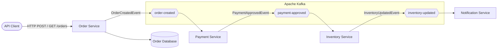
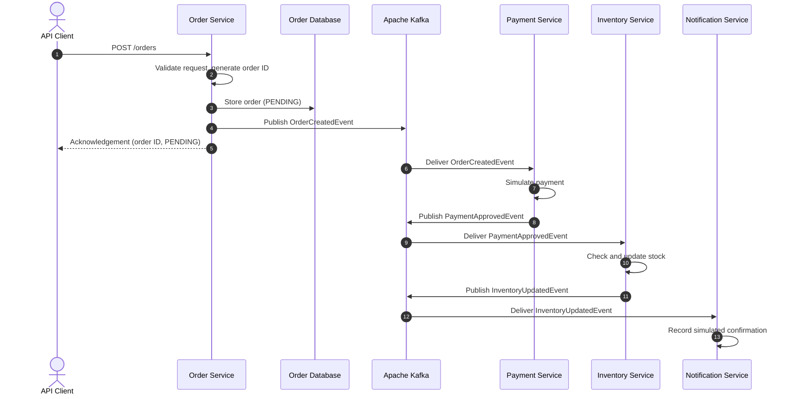
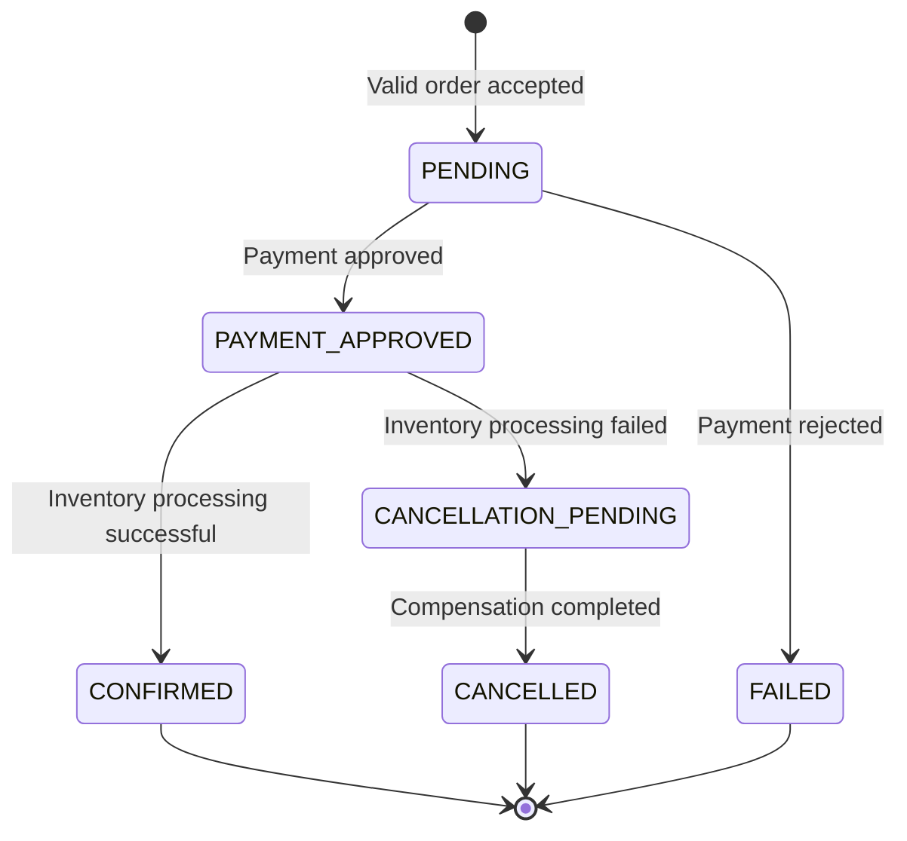
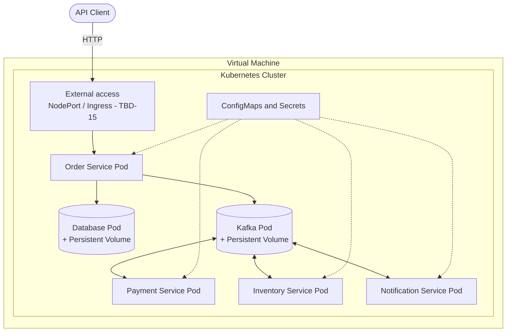

# Software Requirements Specification

## for

# Event-Driven Order Processing System

**Version:** 1.1 (Draft)

Prepared by Elfadel Mohamed, Rachid Boufous, and Chedy

University of Debrecen

Faculty: Faculty of Informatics

Date: 27 October 2026

Copyright © 1999 by Karl E. Wiegers. Permission is granted to use, modify, and distribute this document.

## Table of Contents

- [Revision History](#revision-history)
- **[1. Introduction](#1-introduction)**
  - [1.1 Purpose](#11-purpose)
  - [1.2 Document Conventions](#12-document-conventions)
  - [1.3 Intended Audience and Reading Suggestions](#13-intended-audience-and-reading-suggestions)
  - [1.4 Product Scope](#14-product-scope)
  - [1.5 References](#15-references)

- **[2. Overall Description](#2-overall-description)**
  - [2.1 Product Perspective](#21-product-perspective)
  - [2.2 Product Functions](#22-product-functions)
  - [2.3 User Classes and Characteristics](#23-user-classes-and-characteristics)
  - [2.4 Operating Environment](#24-operating-environment)
  - [2.5 Design and Implementation Constraints](#25-design-and-implementation-constraints)
  - [2.6 User Documentation](#26-user-documentation)
  - [2.7 Assumptions and Dependencies](#27-assumptions-and-dependencies)

- **[3. External Interface Requirements](#3-external-interface-requirements)**
  - [3.1 User Interfaces](#31-user-interfaces)
  - [3.2 Hardware Interfaces](#32-hardware-interfaces)
  - [3.3 Software Interfaces](#33-software-interfaces)
  - [3.4 Communications Interfaces](#34-communications-interfaces)

- **[4. System Features](#4-system-features)**
  - [4.1 Order Creation and Management](#41-order-creation-and-management)
  - [4.2 Payment Processing](#42-payment-processing)
  - [4.3 Inventory Processing](#43-inventory-processing)
  - [4.4 Customer Notification](#44-customer-notification)
  - [4.5 Order Status Tracking](#45-order-status-tracking)
  - [4.6 Error Handling and Recovery](#46-error-handling-and-recovery)
  - [4.7 Containerization and Kubernetes Deployment](#47-containerization-and-kubernetes-deployment)

- **[5. Other Nonfunctional Requirements](#5-other-nonfunctional-requirements)**
  - [5.1 Performance Requirements](#51-performance-requirements)
  - [5.2 Safety Requirements](#52-safety-requirements)
  - [5.3 Security Requirements](#53-security-requirements)
  - [5.4 Software Quality Attributes](#54-software-quality-attributes)
  - [5.5 Business Rules](#55-business-rules)

- **[6. Other Requirements](#6-other-requirements)**
  - [6.1 Database and Data Persistence](#61-database-and-data-persistence)
  - [6.2 Event Data and Schema Compatibility](#62-event-data-and-schema-compatibility)
  - [6.3 Configuration Management](#63-configuration-management)
  - [6.4 Data Retention and Recovery](#64-data-retention-and-recovery)
  - [6.5 Software Reuse and Licensing](#65-software-reuse-and-licensing)
  - [6.6 Internationalization and Localization](#66-internationalization-and-localization)
  - [6.7 Legal and Regulatory Requirements](#67-legal-and-regulatory-requirements)
  - [6.8 Project Deliverables](#68-project-deliverables)

- **[Appendix A: Glossary](#appendix-a-glossary)**
- **[Appendix B: Analysis Models](#appendix-b-analysis-models)**
  - [B.1 System Architecture Model](#b1-system-architecture-model)
  - [B.2 Order Processing Sequence Model](#b2-order-processing-sequence-model)
  - [B.3 Order State Transition Model](#b3-order-state-transition-model)
  - [B.4 Kubernetes Deployment Model](#b4-kubernetes-deployment-model)
  - [B.5 Model Limitations and Future Refinement](#b5-model-limitations-and-future-refinement)

- **[Appendix C: To Be Determined List](#appendix-c-to-be-determined-list)**
  - [C.1 Unresolved Requirements and Decisions](#c1-unresolved-requirements-and-decisions)
  - [C.2 Decision Priorities](#c2-decision-priorities)
  - [C.3 Decision Tracking](#c3-decision-tracking)
  - [C.4 Decision Management](#c4-decision-management)

## Revision History

| Name                                   | Date       | Reason For Changes                                                                                                                                     | Version     |
| -------------------------------------- | ---------- | ------------------------------------------------------------------------------------------------------------------------------------------------------ | ----------- |
| Elfadel Mohamed, Rachid Boufous, Chedy | 26/10/2026 | Initial creation of the Software Requirements Specification                                                                                            | 1.0 (Draft) |
| Elfadel Mohamed, Rachid Boufous, Chedy | 27/10/2026 | Removed template placeholder, resolved duplicate requirements, unified NFR format, added Mermaid analysis models, linked Architecture Decision Records | 1.1 (Draft) |

# 1. Introduction

## 1.1 Purpose

The purpose of this Software Requirements Specification (SRS) document is to define the functional and non-functional requirements of the Event-Driven Order Processing System, an application designed to demonstrate asynchronous order processing using Microservices and Event-Driven Architecture.

The system consists of four main microservices: Order Service, Payment Service, Inventory Service, and Notification Service. These services communicate asynchronously through Apache Kafka to process customer orders without relying on direct synchronous communication between services.

This document specifies the expected system behavior, external interfaces, functional requirements, performance expectations, quality attributes, and technical constraints. It also establishes the requirements for containerization and deployment using Docker and Kubernetes on a virtual machine.

The SRS serves as a reference for the development team throughout the design, implementation, testing, and deployment phases of the project. It also provides the course instructor with a basis for evaluating whether the implemented system satisfies the defined requirements.

This specification covers the complete order-processing workflow, from order creation to payment processing, inventory updates, and customer notification. The system is intended as an educational prototype, with payment processing and customer notifications simulated rather than integrated with real-world payment or messaging providers.

## 1.2 Document Conventions

This document follows the structure of the IEEE Software Requirements Specification (SRS) template provided for the Advanced Software Architecture Patterns course. Markdown formatting is used to organize sections, subsections, tables, and requirement descriptions.

The following conventions are applied throughout the document:

- **Functional Requirements (FR):** Identified using the format `FR-` followed by a sequential number (e.g., `FR-01`, `FR-100`). These describe the functions and behaviors the system must provide.
- **Non-Functional Requirements (NFR):** Identified using the format `NFR-` followed by a sequential number (e.g., `NFR-01`, `NFR-70`). These describe system quality attributes, such as performance, reliability, security, and scalability.
- **Business Rules (BR):** Identified using the format `BR-` followed by a sequential number (e.g., `BR-01`). These define conditions and constraints governing the order-processing workflow.
- **MUST:** Indicates a mandatory requirement that must be satisfied by the completed system.
- **SHOULD:** Indicates a recommended requirement that is desirable but not mandatory.
- **TBD (To Be Determined):** Indicates information or decisions that have not yet been finalized.
- **ADR (Architecture Decision Record):** Architecturally significant decisions are recorded as separate Markdown files in the `docs/adr/` folder and referenced as `ADR-NNNN` (e.g., `ADR-0002`).

Requirements are assigned one of the following priority levels:

| Priority | Description                                                                                                                         |
| -------- | ----------------------------------------------------------------------------------------------------------------------------------- |
| High     | Essential functionality or constraints required for the system to operate correctly and satisfy the project's main objectives.      |
| Medium   | Important functionality that improves system reliability, usability, or maintainability but is not essential to the basic workflow. |
| Low      | Optional enhancements that may be implemented if time and resources permit.                                                         |

Each requirement is assigned a unique identifier to support traceability during implementation and testing. Requirement identifiers remain unchanged when the document is revised.

Technical terms, such as _microservices_, _event-driven architecture_, and _Apache Kafka_, are used consistently throughout the document. Abbreviations and specialized terminology are defined in Appendix A: Glossary.

Any sections that are not applicable to the project are retained and explicitly marked **Not Applicable (N/A)**, while unresolved requirements are marked **TBD**.

## 1.3 Intended Audience and Reading Suggestions

This Software Requirements Specification is intended for the following audiences:

- Course Instructor: To review the project's scope, functional and non-functional requirements, architectural constraints, and expected system behavior, and to evaluate whether the completed implementation satisfies the specified requirements.
- Development Team: To understand the required system functionality, service responsibilities, communication mechanisms, and technical constraints during design and implementation.
- Testers: To identify expected system behaviors and acceptance criteria, design test cases, and verify that functional and non-functional requirements are satisfied.
- System Administrators and Operators: To understand the system's operating environment, deployment constraints, external interfaces, and reliability requirements when deploying and managing the application using Docker and Kubernetes.
  The document is organized into six main chapters and three appendices:
- Chapter 1 – Introduction: Describes the document's purpose, conventions, intended audience, project scope, and references.
- Chapter 2 – Overall Description: Provides an overview of the system, its major functions, users, operating environment, constraints, and dependencies.
- Chapter 3 – External Interface Requirements: Defines the interfaces through which the system interacts with users, hardware, external software, and communication infrastructure.
- Chapter 4 – System Features: Specifies the system's functional requirements, including order creation, payment processing, inventory updates, and customer notifications.
- Chapter 5 – Other Nonfunctional Requirements: Defines performance, security, reliability, scalability, maintainability, and other quality requirements.
- Chapter 6 – Other Requirements: Covers additional requirements not addressed in the preceding chapters.
- Appendices: Provide definitions of technical terminology, supporting analysis models, and a list of unresolved decisions.
  Readers unfamiliar with the project are encouraged to begin with Chapters 1 and 2 to understand its objectives and overall functionality.

Developers and testers should then focus on Chapters 3, 4, and 5, while system administrators and operators should pay particular attention to the operating environment, implementation constraints, communication interfaces, and deployment-related requirements.

## 1.4 Product Scope

The Event-Driven Order Processing System is a distributed application designed to simulate and manage the main stages of an online order-processing workflow. The system handles order creation, payment processing, inventory updates, and customer notifications through independently deployable microservices.

### Problem Statement

In a traditional synchronous order-processing system, different operations may be connected through a sequence of direct service-to-service requests. When a customer places an order, the system may need to wait for payment processing, inventory updates, and notification services to complete before returning a response.

This approach can introduce several architectural problems:

- Blocking dependencies: Slow downstream operations can increase the overall response time.
- Tight coupling: Services depend directly on the availability and interfaces of other services.
- Limited fault isolation: A failure in one service can disrupt the entire order-processing workflow.
- Difficult scalability: Individual processing stages may be difficult to scale independently.
- Reduced modifiability: Adding new functionality may require changes to existing service interactions.

### Proposed Solution

The proposed system addresses these problems by combining Microservices Architecture with Event-Driven Architecture (EDA).

The application is divided into four main microservices:

- **Order Service:** Receives customer orders, stores order information, and publishes an order-created event.
- **Payment Service:** Consumes order-created events, simulates payment processing, and publishes payment-result events.
- **Inventory Service:** Processes successful payment events, performs inventory operations, and publishes inventory-update events.
- **Notification Service:** Consumes inventory-update events and generates customer confirmation notifications.

Instead of directly invoking each other for business operations, the services communicate asynchronously through Apache Kafka, which acts as the event broker.

This allows the Order Service to acknowledge an accepted order without waiting for all downstream operations to complete. Other services process the relevant events independently as they become available.

### Project Objectives

The main objectives of the system are:

- **Responsiveness:** Reduce blocking dependencies by allowing order requests to be acknowledged before downstream processing finishes.
- **Fault Isolation:** Limit the impact of individual service failures on the rest of the order-processing system.
- **Scalability:** Enable individual microservices to be scaled independently according to their processing workload.
- **Modifiability:** Allow new event consumers or processing capabilities to be introduced with minimal changes to existing services.
- **Reliability:** Support consistent order processing and recovery from temporary service failures.
- **Deployability:** Package the application using Docker containers and deploy the microservices on a virtual machine using Kubernetes.

### Project Boundaries

The project focuses on demonstrating the architectural behavior of a distributed, event-driven order-processing system.

**In Scope:**

- Creation and basic validation of customer orders.
- Asynchronous communication using Apache Kafka.
- Simulated payment processing.
- Inventory processing and updates.
- Simulated customer notifications.
- Basic order status tracking.
- Containerization of application services using Docker.
- Deployment and management using Kubernetes.
- Testing of service communication, failure handling, and selected architectural quality attributes.

**Out of Scope:**

- Integration with real banks or payment gateways.
- Processing actual financial transactions.
- Integration with commercial shipping or delivery providers.
- Implementation of a complete e-commerce storefront.
- Real-world customer billing and invoicing.
- Production-scale deployment across multiple cloud regions.

The system is intended as an educational prototype for the Advanced Software Architecture Patterns course at the University of Debrecen. Its primary purpose is to demonstrate and evaluate architectural patterns rather than provide a production-ready e-commerce platform.

## 1.5 References

The following documents and resources were used as references for preparing this Software Requirements Specification.

[REF-01] Event-Driven Order System — Reference Implementation

Author: Flavio Carvalho (FL4V10ARC)

Description: Open-source reference implementation of an event-driven order-processing system using Spring Boot microservices and Apache Kafka.

**Source:** [GitHub — Event-Driven Order System](https://github.com/FL4V10ARC/event-driven-order-system)

Accessed: 26 October 2026

[REF-02] Advanced Software Architecture Project Proposal

Author: Project Team

Document: Advanced Software Architecture Project Proposal

Description: Academic project proposal describing the problem of synchronous order processing, the proposed Event-Driven Microservices Architecture, its expected quality attributes, and architectural trade-offs.

Source: Project documentation provided for the Advanced Software Architecture Patterns course, University of Debrecen.

[REF-03] Ordering System — Event-Driven Architecture

Author: Project Team

Document: Ordering System: Event-Driven Microservices with Apache Kafka

Description: Project presentation introducing the order-processing workflow, architectural problems, proposed solution, benefits, and trade-offs.

Source: Project presentation prepared for the Advanced Software Architecture Patterns course, University of Debrecen.

[REF-04] IEEE Software Requirements Specification Template

Original Author: Karl E. Wiegers

Document: Software Requirements Specification Template

Description: IEEE-style SRS template used to structure and document the system's functional and non-functional requirements.

Source: SRS template provided by the course instructor.

Original Copyright: © 1999 Karl E. Wiegers.

[REF-05] Architecture Decision Records

Author: Architecture Decision Record community

Document: Architecture Decision Record (ADR)

Description: Reference material for documenting important software architecture decisions, including their context, rationale, and consequences.

**Source:** [GitHub — Architecture Decision Records](https://github.com/architecture-decision-record/architecture-decision-record)

Accessed: 26 October 2026.

[REF-06] Project Architecture Decision Records

Author: Elfadel Mohamed, Rachid Boufous, Chedy

Description: The project's own ADRs (ADR-0001 to ADR-0008), documenting the architectural decisions and proposals referenced in this SRS.

Source: [`docs/adr/`](docs/adr/README.md) in the project repository.

# 2. Overall Description

## 2.1 Product Perspective

The Event-Driven Order Processing System is a distributed, event-driven application designed to demonstrate asynchronous communication and independent service deployment within an online order-processing workflow.

The project is based on the open-source Event-Driven Order System developed by Flavio Carvalho. The reference implementation provides a foundation consisting of four Spring Boot microservices communicating through Apache Kafka. The proposed project extends this foundation to support additional requirements, improved reliability, containerization, and deployment using Kubernetes.

The system is designed as a self-contained educational prototype rather than as a replacement for an existing commercial e-commerce platform.

### System Architecture

The system follows a combination of Microservices Architecture and Event-Driven Architecture (EDA).

Its main components are:

1. **Order Service:** Provides the HTTP interface for creating orders, validates incoming requests, stores order information, and publishes events when orders are created.
2. **Payment Service:** Receives order-created events, performs simulated payment processing, and publishes payment-result events.
3. **Inventory Service:** Receives successful payment events, processes inventory updates, and publishes events indicating successful inventory operations.
4. **Notification Service:** Receives inventory-update events and generates simulated customer confirmations.
5. **Apache Kafka:** Acts as the event broker, enabling asynchronous communication between the microservices.

Each microservice has a separate business responsibility and communicates with other services through events rather than direct synchronous business requests.

### System Interaction

The order-processing workflow begins when a client submits an order through the Order Service's HTTP API.

After validating and accepting the order, the Order Service stores the order information and publishes an OrderCreatedEvent to Apache Kafka.

The Payment Service consumes this event and performs simulated payment processing. When payment is approved, it publishes a PaymentApprovedEvent.

The Inventory Service consumes the payment-approved event, performs an inventory operation, and publishes an InventoryUpdatedEvent.

Finally, the Notification Service consumes the inventory-updated event and generates a simulated order confirmation.

Because these operations are performed asynchronously, the initial order request does not need to wait for the entire processing workflow to finish.

### Deployment Perspective

The completed application is intended to run in a containerized environment.

Each microservice will be packaged as a Docker container image and deployed within a Kubernetes cluster hosted on a virtual machine.

Kubernetes will be responsible for managing application containers, service networking, deployment configuration, and container lifecycle operations.

Apache Kafka will provide the messaging infrastructure required for asynchronous communication between the services.

The deployment architecture is intended to demonstrate independent service management, fault isolation, and horizontal scaling within the resource limitations of the virtual machine.

### External Dependencies

The system depends on the following external technologies and infrastructure:

- Apache Kafka: Event streaming and asynchronous message delivery.
- Java and Spring Boot: Application development and execution.
- Database Management System: Storage of order information and other persistent application data.
- Docker: Packaging and distribution of the application services.
- Kubernetes: Container orchestration and service deployment.
- Virtual Machine: Infrastructure hosting the Kubernetes cluster.
  The system does not require integration with external banking services, commercial payment gateways, or real customer notification providers. Such operations are simulated for educational purposes.

## 2.2 Product Functions

The Event-Driven Order Processing System provides a set of interconnected functions that support asynchronous order processing through independent microservices.

The major functions of the system are described below.

### 1. Order Creation and Management

The system allows clients to submit orders through an HTTP API.

The Order Service validates incoming order information, creates an order record, assigns a unique identifier, and publishes an event indicating that a new order has been created.

The system acknowledges accepted orders without waiting for payment, inventory, and notification processing to complete.

### 2. Payment Processing

The Payment Service automatically processes newly created orders by consuming order-created events from Apache Kafka.

Payment processing is simulated for educational purposes and does not involve real financial transactions.

The system is intended to support successful and unsuccessful payment outcomes. Successful payments trigger the next stage of the order-processing workflow.

### 3. Inventory Processing

The Inventory Service processes inventory operations after receiving events indicating successful payment.

It is responsible for updating the inventory state associated with an order and publishing an event when the inventory operation completes successfully.

The proposed system also aims to support handling of inventory-related failures, such as insufficient stock.

### 4. Customer Notification

The Notification Service processes events generated after successful inventory operations.

It generates simulated customer confirmations indicating that an order has completed the required processing stages.

Notifications are handled asynchronously so that notification processing does not block order creation or other completed operations.

### 5. Order Status Tracking

The system is intended to provide a mechanism for retrieving the current processing status of an order.

This allows clients to distinguish between an order that has been accepted and an order that has completed the necessary payment and inventory operations.

Order status information reflects the asynchronous nature of the system, where different processing stages may complete at different times.

### 6. Event-Based Communication

The system uses Apache Kafka to exchange events between microservices.

Each service consumes events relevant to its responsibilities and publishes new events when appropriate.

This communication mechanism reduces direct dependencies between services and allows individual processing stages to operate independently.

### 7. Failure Handling and Recovery

The system is intended to support recovery from temporary service failures.

When a downstream service becomes unavailable, previously published events may remain available in Kafka for processing after the service recovers, subject to message retention and consumer configuration.

The proposed system will include mechanisms for handling processing failures and reducing the risk of duplicate operations.

### 8. Containerized Deployment and Management

The application will support containerized deployment using Docker and Kubernetes.

Each microservice will be packaged into a container image and deployed independently within a Kubernetes cluster hosted on a virtual machine.

The deployment will allow operators to manage service instances, inspect application logs, restart failed containers, and demonstrate independent service scaling.

These functions collectively support the project's objective of demonstrating responsiveness, fault isolation, scalability, and modifiability through Microservices and Event-Driven Architecture.

## 2.3 User Classes and Characteristics

The Event-Driven Order Processing System is designed primarily as an educational prototype for demonstrating distributed software architecture. Users interact with the system through its HTTP API, development tools, and deployment infrastructure rather than through a dedicated graphical user interface.

The following user classes have been identified:

### 1. API Client (Simulated Customer)

The API Client represents a customer or external application that interacts with the Order Service.

Its primary responsibility is to submit order requests and retrieve information about the processing status of submitted orders.

**Characteristics:**

- Interacts with the system through HTTP requests.
- Does not require knowledge of the internal microservices architecture.
- Expects valid order requests to be acknowledged without waiting for all downstream operations to complete.
- May retrieve order-processing information through a status endpoint.
- Does not interact directly with Apache Kafka or individual downstream microservices.
  **Priority:** High

### 2. System Administrator / Operator

The System Administrator is responsible for deploying, configuring, monitoring, and maintaining the application infrastructure.

This user interacts with Docker, Kubernetes, and application monitoring or logging tools.

**Characteristics:**

- Possesses technical knowledge of containerization and distributed systems.
- Deploys and manages the application within the Kubernetes cluster.
- Monitors application health, service availability, and processing errors.
- Inspects service logs to diagnose problems.
- Restarts or scales individual services when necessary.
- Manages application configuration and infrastructure resources.
  **Priority:** High

### 3. Developer / Tester

The Developer or Tester is responsible for implementing, maintaining, and verifying the system's functionality and architectural behavior.

This user interacts with the application source code, development environment, HTTP API, event broker, and testing tools.

**Characteristics:**

- Possesses knowledge of Java, Spring Boot, Apache Kafka, and microservices.
- Develops and maintains individual application services.
- Tests the complete order-processing workflow.
- Verifies event production and consumption between services.
- Simulates service failures and evaluates recovery behavior.
- Validates functional and non-functional requirements.
- Investigates system behavior using application logs and testing tools.
  **Priority:** High

### User Class Summary

| User Class                      | Primary Interaction                         | Main Responsibilities                           | Priority |
| ------------------------------- | ------------------------------------------- | ----------------------------------------------- | -------- |
| API Client (Simulated Customer) | HTTP API                                    | Submit orders and retrieve order status         | High     |
| System Administrator / Operator | Docker, Kubernetes, system logs             | Deploy, monitor, configure, and manage services | High     |
| Developer / Tester              | Source code, HTTP API, Kafka, testing tools | Implement, test, debug, and verify the system   | High     |

The system does not currently require separate administrative interfaces, customer authentication, or role-based access control for its educational demonstration.

Additional user classes may be introduced if the project scope is expanded in future versions.

## 2.4 Operating Environment

The Event-Driven Order Processing System is designed to operate in a containerized environment hosted on a virtual machine (VM). The application consists of independent Java-based microservices that communicate asynchronously using Apache Kafka.

The project supports two operating environments: a local development environment and a Kubernetes-based deployment environment.

### 2.4.1 Local Development Environment

The local development environment is used for implementing, testing, and debugging the microservices before deployment.

The reference implementation uses the following technologies:

| Component             | Technology        | Purpose                                                 |
| --------------------- | ----------------- | ------------------------------------------------------- |
| Programming Language  | Java 21           | Implementation of the microservices                     |
| Application Framework | Spring Boot 3.3.5 | Development of standalone application services          |
| Build Tool            | Apache Maven      | Dependency management and application builds            |
| Message Broker        | Apache Kafka      | Asynchronous communication between services             |
| Database              | H2 Database       | In-memory order storage in the reference implementation |
| Containerization      | Docker            | Packaging and running containerized components          |
| Local Infrastructure  | Docker Compose    | Running Kafka infrastructure during development         |
| Operating System      | Windows or Linux  | Local development and testing                           |

Development tools such as an IDE, HTTP API testing client, and Git may be used to implement and verify the application.

### 2.4.2 Deployment Environment

The completed system will be deployed on a virtual machine using a Kubernetes-based container orchestration environment.

The target deployment will contain the four application microservices, Apache Kafka, and the database components required for the selected persistence strategy.

| Component               | Target Environment                                   |
| ----------------------- | ---------------------------------------------------- |
| Hosting Infrastructure  | Virtual Machine (VM)                                 |
| Operating System        | Linux-based Kubernetes host                          |
| Container Images        | Docker-built OCI-compatible images                   |
| Container Orchestration | Kubernetes                                           |
| Application Runtime     | Java 21                                              |
| Application Framework   | Spring Boot                                          |
| Event Broker            | Apache Kafka                                         |
| Database                | To Be Determined (TBD)                               |
| Application Networking  | Kubernetes Services                                  |
| External API Access     | Kubernetes networking or ingress configuration (TBD) |

Each microservice will run as an independently managed Kubernetes workload.

Kubernetes will provide service discovery, container lifecycle management, restart capabilities, and configurable application scaling.

### 2.4.3 Hardware Requirements

The deployment environment must provide sufficient computing resources to execute the application microservices, Apache Kafka, Kubernetes components, and the selected database.

The exact minimum hardware requirements have not yet been established and will depend on the available virtual machine and the final deployment configuration.

The following specifications remain to be determined:

- Number of available virtual CPUs.
- Amount of system memory (RAM).
- Available disk storage.
- Network configuration and external connectivity.
- Persistent storage requirements.
  The final resource requirements will be documented and validated during deployment testing.

### 2.4.4 Network and Communication Environment

The system requires network connectivity between its microservices and Apache Kafka.

External clients will communicate with the Order Service through an HTTP-based API.

Internal business communication between microservices will use Apache Kafka topics rather than direct synchronous service-to-service calls.

Within Kubernetes, services will use the cluster's networking and service-discovery mechanisms to communicate with the required infrastructure components.

The exact external access method and network security configuration will be determined during deployment design.

### 2.4.5 Environment Compatibility

The application will be packaged into container images to provide consistent runtime dependencies across development and deployment environments.

Environment-specific configuration, such as Kafka broker addresses, database connection settings, and service ports, will be supplied through external configuration rather than embedded directly in the application code.

The system must support deployment on the selected Kubernetes environment without requiring modifications to its core business logic.

## 2.5 Design and Implementation Constraints

The design and implementation of the Event-Driven Order Processing System are subject to several architectural, technological, and infrastructure constraints. These constraints ensure that the system satisfies the objectives of the Advanced Software Architecture Patterns course while remaining compatible with the selected reference implementation.

### 2.5.1 Architectural Constraints

The system must follow a combination of **Microservices Architecture** and **Event-Driven Architecture (EDA)**.

The following architectural constraints apply:

- The application must consist of independently deployable microservices with clearly defined responsibilities.
- The main business functions must be separated into Order, Payment, Inventory, and Notification services.
- Communication between microservices for order-processing operations must be asynchronous and event-driven.
- Apache Kafka must be used as the event broker for exchanging events between services.
- Microservices must not rely on direct synchronous service-to-service calls to execute the main order-processing workflow.
- Each microservice should remain independently maintainable and deployable without requiring modifications to unrelated services.
- The system must account for eventual consistency resulting from asynchronous processing.

### 2.5.2 Technology Constraints

The project is based on an existing Java and Spring Boot implementation.

The following technologies are selected for the application:

| Technology      | Constraint                                                                 |
| --------------- | -------------------------------------------------------------------------- |
| Java 21         | Primary programming language                                               |
| Spring Boot     | Framework for implementing the microservices                               |
| Apache Kafka    | Required asynchronous communication infrastructure                         |
| Apache Maven    | Application build and dependency management                                |
| Docker          | Building and packaging container images                                    |
| Kubernetes      | Deployment and orchestration of application containers                     |
| Database System | Selected database must support the application's data storage requirements |

The database technology and persistence strategy will be finalized during implementation planning.

### 2.5.3 Communication Constraints

External clients will interact with the Order Service using an HTTP-based API with JSON-formatted requests and responses.

Internal communication between the microservices must use Apache Kafka events.

Each microservice must publish and consume events according to defined message structures to ensure compatibility between producers and consumers.

Communication failures must not require the entire system to stop processing unrelated operations.

The system must provide mechanisms for handling temporary service unavailability and unsuccessful event processing.

### 2.5.4 Deployment Constraints

The completed application must be deployable on a virtual machine using Kubernetes.

The following deployment constraints apply:

- Each application microservice must be packaged as a container image.
- Kubernetes configuration must define the workloads and networking resources required to run the application.
- Apache Kafka must be accessible to the microservices within the deployment environment.
- Application configuration must support differences between development and deployment environments.
- Deployment must operate within the available CPU, memory, storage, and networking resources of the virtual machine.
- The deployment must support independent management and restarting of individual microservices.

The exact Kubernetes distribution and virtual machine specifications will be confirmed according to the course requirements.

### 2.5.5 Data Management Constraints

The system must maintain the information required to create and process orders.

The following constraints apply:

- Order information must be stored in a database.
- Each order must have a unique identifier.
- Events exchanged between microservices must contain sufficient information to identify the associated order.
- The data management approach must account for asynchronous updates and eventual consistency.
- The system must prevent repeated processing of the same event from causing unintended duplicate business operations.
- Persistence requirements and database ownership will be defined before final implementation.

### 2.5.6 Security Constraints

The application must apply basic security practices appropriate for an educational distributed system.

The following constraints apply:

- Incoming API requests must be validated.
- Sensitive configuration values must not be hard-coded into application source code.
- Communication interfaces must be restricted to the components and users that require access.
- Internal infrastructure services should not be unnecessarily exposed to external networks.
- The system must not process real financial transactions or store actual payment-card information.

### 2.5.7 Project Scope and Resource Constraints

The project is developed within the time and resource limitations of an academic course.

Consequently:

- The implementation will focus on demonstrating the selected architectural patterns and their quality attributes.
- Payment processing and customer notifications will be simulated.
- The system will not require integration with commercial banking, payment, or delivery services.
- The application will be designed for demonstration and evaluation rather than production-scale commercial operation.
- Additional functionality may be limited to maintain a manageable implementation and deployment scope.

## 2.6 User Documentation

The Event-Driven Order Processing System will be accompanied by technical documentation to support its installation, configuration, operation, testing, and maintenance.

Since the application is primarily an API-based educational prototype, the documentation will focus on developers, testers, and system administrators rather than end users of a graphical interface.

The following documentation will be provided:

### 1. Project README

A `README.md` file will be maintained in the project's GitHub repository.

It will provide:

- An overview of the project and its objectives.
- A description of the system architecture and main microservices.
- The technologies and dependencies used.
- Instructions for obtaining and building the source code.
- Instructions for running the application locally.
- Example requests for testing the order-processing workflow.
- References to additional technical documentation.

### 2. API Documentation

API documentation will describe the HTTP endpoints exposed by the application.

It will include:

- Available API endpoints and their purposes.
- Supported HTTP methods.
- Request and response formats.
- Required and optional parameters.
- Example JSON requests and responses.
- Expected error responses.

The documentation will enable API clients and testers to interact with the system without requiring knowledge of its internal implementation.

### 3. Architecture Documentation

Architecture documentation will describe the organization and communication of the system's components.

It will include:

- An overview of the Microservices and Event-Driven architectural patterns.
- The responsibilities of each microservice.
- Architecture and communication diagrams.
- Apache Kafka topics and event flows.
- Important architectural decisions and their rationale.
- Architectural trade-offs and selected quality attributes.

### 4. Deployment and Configuration Guide

A deployment guide will describe how to deploy and operate the application using Docker and Kubernetes on a virtual machine.

It will include:

- Deployment prerequisites.
- Container image build instructions.
- Required application configuration.
- Kubernetes deployment instructions.
- Service networking and connectivity requirements.
- Procedures for starting, stopping, and restarting services.
- Instructions for accessing application logs.
- Basic troubleshooting procedures.

### 5. Testing and Verification Documentation

Testing documentation will describe the procedures used to verify the system's functional and non-functional requirements.

It will include:

- Test scenarios for the order-processing workflow.
- Expected results for successful and unsuccessful operations.
- Procedures for testing communication between microservices.
- Service failure and recovery test scenarios.
- Procedures for evaluating selected architectural quality attributes.
- A summary of test results and observed system behavior.

### Documentation Formats

The primary documentation format will be **Markdown (`.md`)**, stored alongside the application's source code in the GitHub repository.

The final project report may additionally be provided in PDF format for academic submission.

A separate graphical user manual is not required because the project does not include a dedicated graphical user interface.

## 2.7 Assumptions and Dependencies

The design, implementation, and deployment of the Event-Driven Order Processing System rely on several assumptions and external dependencies. Changes to these conditions may affect the system's functionality, performance, or deployment feasibility.

### 2.7.1 Assumptions

The following assumptions are considered during the development of the system:

**A-01: Virtual Machine Availability**

It is assumed that a virtual machine will be available for hosting the Kubernetes environment and the application components.

The virtual machine is expected to provide sufficient CPU, memory, storage, and networking resources to run the required services.

**A-02: Development Environment**

It is assumed that the development team has access to the tools required to build, test, and containerize the application, including Java, Maven, Docker, and Git.

**A-03: Apache Kafka Availability**

It is assumed that Apache Kafka will be operational during normal system execution and accessible to all microservices that publish or consume events.

Temporary broker failures may affect event delivery and processing until communication is restored.

**A-04: Simulated External Operations**

Payment processing and customer notifications are assumed to be simulated.

The system will not depend on real banking systems, payment gateways, email providers, or SMS services.

**A-05: Reference Implementation**

It is assumed that the existing open-source Event-Driven Order System provides a suitable foundation for the project.

The development team may modify or extend the reference implementation to satisfy the requirements defined in this specification.

**A-06: Educational Workload**

The system is expected to operate under a limited workload appropriate for an academic demonstration.

Production-scale traffic and large numbers of simultaneous users are outside the intended scope.

**A-07: Containerized Deployment**

It is assumed that the selected virtual machine and Kubernetes environment will support the container images and infrastructure components required by the application.

### 2.7.2 External Dependencies

The system depends on the following technologies and infrastructure:

| ID   | Dependency                    | Description                                                                        |
| ---- | ----------------------------- | ---------------------------------------------------------------------------------- |
| D-01 | Java Runtime                  | Required to execute the Spring Boot microservices.                                 |
| D-02 | Spring Boot                   | Provides the application framework for implementing the microservices.             |
| D-03 | Apache Kafka                  | Provides asynchronous event communication between services.                        |
| D-04 | Database System               | Stores order information and any additional persistent application state.          |
| D-05 | Docker / OCI Container Images | Provides the application packaging format used for deployment.                     |
| D-06 | Kubernetes                    | Manages application workloads, networking, and container lifecycle operations.     |
| D-07 | Virtual Machine               | Provides the computing infrastructure for the deployed system.                     |
| D-08 | Network Connectivity          | Enables communication between clients, application services, Kafka, and databases. |

### 2.7.3 Dependency-Related Risks

Failures or limitations affecting external dependencies may influence the behavior of the system.

The following risks have been identified:

- **Kafka unavailability:** Microservices may be unable to publish or consume events until broker connectivity is restored.
- **Database unavailability:** Services may be unable to create, retrieve, or update information that requires persistent storage.
- **Insufficient VM resources:** Limited CPU, memory, or storage may prevent components from starting correctly or reduce processing performance.
- **Kubernetes deployment failures:** Incorrect configuration or unavailable cluster resources may prevent application workloads from running.
- **Network failures:** Communication interruptions may delay event delivery or prevent clients from accessing the application's HTTP API.
- **Reference implementation limitations:** Existing functionality may require modifications to support persistent storage, error handling, and Kubernetes deployment.

These risks will be considered during implementation, integration testing, and deployment planning.

### 2.7.4 Unresolved Dependencies

The following decisions remain to be determined:

- Exact virtual machine hardware specifications.
- Final Kubernetes distribution and configuration.
- Database technology and persistence strategy.
- Kafka deployment configuration and persistence requirements.
- External API access and networking configuration.
- Detailed failure recovery and event retry mechanisms.

These unresolved items will be tracked in **Appendix C: To Be Determined List** and updated as implementation decisions are finalized.

# 3. External Interface Requirements

## 3.1 User Interfaces

The Event-Driven Order Processing System is designed primarily as an API-based application and does not require a dedicated graphical user interface (GUI).

Users interact with the application through an HTTP API exposed by the Order Service. The interface allows clients to submit orders and, in the proposed extended implementation, retrieve information about their processing status.

The system's API can be accessed using HTTP clients such as Postman, cURL, or other applications capable of sending HTTP requests.

### 3.1.1 Order Submission Interface

The Order Service provides an HTTP endpoint through which clients can submit new orders.

The interface accepts order information in JSON format, including:

- Product identifier.
- Order quantity.
- Product price.

When a valid order is accepted, the system returns an acknowledgement containing information that allows the client to identify the submitted order.

The acknowledgement does not require all downstream operations, such as payment processing, inventory updates, and customer notification, to be completed.

### 3.1.2 Order Status Interface

The proposed system will provide an HTTP interface for retrieving the processing status of an existing order.

Clients will be able to request information about an order using its unique identifier.

The returned information will indicate the latest known processing state, allowing clients to distinguish between orders that have been accepted, are being processed, or have completed processing.

The exact endpoint structure, response format, and supported status values will be defined in the functional and interface requirements.

### 3.1.3 Error Handling and Feedback

The HTTP interface must provide understandable responses when a request cannot be processed.

The system must:

- Reject requests containing invalid or missing required information.
- Return appropriate HTTP status codes.
- Provide error descriptions in a consistent JSON format.
- Distinguish between successful order acceptance and unsuccessful requests.
- Avoid exposing sensitive internal implementation details through error messages.

### 3.1.4 Administrative and Development Interfaces

Developers and system operators will interact with the application using development, testing, and infrastructure-management tools.

These interfaces may include:

- HTTP API testing tools for submitting requests and inspecting responses.
- Application logs for observing order-processing events.
- Docker tools for building and inspecting container images.
- Kubernetes command-line tools for monitoring and managing deployed services.

These tools are external utilities and are not custom graphical interfaces developed as part of the application.

### 3.1.5 Graphical User Interface

A dedicated graphical user interface is **Not Applicable (N/A)** to the current project scope.

The system does not require customer registration screens, shopping-cart interfaces, administrative dashboards, or other graphical e-commerce components.

Such interfaces may be developed in future versions without changing the main event-driven processing architecture.

## 3.2 Hardware Interfaces

**Not Applicable (N/A) — Direct Hardware Interfaces.**

The Event-Driven Order Processing System is a software-based distributed application and does not require direct communication with specialized physical hardware, sensors, embedded devices, or external peripherals.

The application will operate within a virtualized computing environment, where hardware resources such as CPU, memory, storage, and network interfaces are managed by the underlying operating system and Kubernetes infrastructure.

The microservices interact with these resources indirectly through the Java runtime, operating system, and container environment.

The system does not require custom hardware drivers, device-specific communication protocols, or direct hardware control interfaces.

General computing resource requirements for the virtual machine are described in **Section 2.4 — Operating Environment**.

Therefore, no additional hardware-specific interfaces are required for the current project scope.

## 3.3 Software Interfaces

The Event-Driven Order Processing System consists of independent microservices that interact with external clients, Apache Kafka, database systems, and container orchestration infrastructure.

The system exposes an HTTP API for external clients, while internal business operations are coordinated through asynchronous events published and consumed using Apache Kafka.

The following subsections describe the major software interfaces.

### 3.3.1 HTTP API Interface

The Order Service provides the main software interface through which external applications interact with the system.

The reference implementation exposes an HTTP endpoint for submitting new orders.

| Interface               | Method | Endpoint            | Purpose                                             |
| ----------------------- | ------ | ------------------- | --------------------------------------------------- |
| Order Creation          | POST   | `/orders`           | Submit a new order                                  |
| Order Status (Proposed) | GET    | `/orders/{orderId}` | Retrieve the processing status of an existing order |

Requests and responses use JSON.

The order-creation request includes the following information:

- Product identifier.
- Quantity.
- Product price.

The Order Service validates the submitted information, creates an order record, and initiates asynchronous processing.

The exact response schemas, validation rules, and HTTP status codes will be specified in Chapter 4.

### 3.3.2 Apache Kafka Interface

Apache Kafka provides the messaging infrastructure for asynchronous communication between the microservices.

Each service communicates through Kafka topics by publishing or consuming events relevant to its business responsibilities.

The reference implementation defines the following event interactions:

| Kafka Topic         | Producer          | Consumer             | Purpose                                                      |
| ------------------- | ----------------- | -------------------- | ------------------------------------------------------------ |
| `order-created`     | Order Service     | Payment Service      | Notify the payment service that a new order has been created |
| `payment-approved`  | Payment Service   | Inventory Service    | Indicate successful payment processing                       |
| `inventory-updated` | Inventory Service | Notification Service | Indicate successful inventory processing                     |

Kafka acts as an intermediary between the services, removing the need for direct synchronous business requests between them.

Each microservice must be configured to connect to the Kafka broker and use the appropriate topics for its responsibilities.

### 3.3.3 Event Message Interfaces

Events exchanged between microservices represent changes or outcomes in the order-processing workflow.

The system uses the following primary event types:

**OrderCreatedEvent**

Published by the Order Service after an order has been accepted.

The event initiates payment processing and carries information required to identify and process the associated order.

**PaymentApprovedEvent**

Published by the Payment Service after a simulated payment has been approved.

The event indicates that the order can proceed to inventory processing.

**InventoryUpdatedEvent**

Published by the Inventory Service following a successful inventory operation.

The event triggers the customer notification stage.

For the extended implementation, the system should define consistent event structures that support:

- Unique event identification.
- Order identification.
- Event type identification.
- Event creation timestamps.
- Correlation between related processing events.
- Event schema versioning.

The exact fields and serialization formats will be finalized during interface design.

Additional event types may be introduced to represent unsuccessful payment or inventory operations.

### 3.3.4 Database Interface

The Order Service interacts with a database to store and retrieve order information.

The original reference implementation uses an H2 in-memory database for order persistence.

The completed project may adopt a persistent database to support data recovery after application restarts.

The database interface must support the following operations:

- Creating order records.
- Retrieving existing order information.
- Updating order-processing states where required.
- Maintaining unique identifiers for stored orders.

If persistent inventory or payment records are introduced, the corresponding services will manage their own application data according to the selected data ownership strategy.

The final database technology and persistence configuration remain **To Be Determined (TBD)**.

### 3.3.5 Container and Kubernetes Interfaces

The application will be packaged as container images and deployed through Kubernetes.

Kubernetes provides infrastructure-level interfaces for:

- Deploying individual microservices.
- Configuring application environments.
- Providing internal service discovery.
- Managing application instances.
- Restarting failed containers.
- Inspecting application health and operational status.
- Scaling supported services independently.

The application will use Kubernetes configuration mechanisms to obtain environment-specific settings, including Kafka broker addresses and database connection information.

Kubernetes is responsible for infrastructure orchestration and does not replace Apache Kafka as the communication mechanism for business events.

### 3.3.6 Software Interface Compatibility

The following compatibility requirements apply:

- All event-producing and event-consuming services must use compatible event schemas.
- Kafka topic names must be consistent between producers and consumers.
- Service configuration must support changes in infrastructure addresses without requiring modifications to business logic.
- Database interfaces must be compatible with the selected persistence technology.
- Container images must be compatible with the selected Kubernetes deployment environment.
- Changes to event structures must be coordinated to avoid breaking dependent consumers.

The detailed communication protocols, message serialization, network configuration, and security requirements are described in **Section 3.4 — Communications Interfaces**.

## 3.4 Communications Interfaces

The Event-Driven Order Processing System uses HTTP-based communication for external client interactions and Apache Kafka for asynchronous communication between microservices.

The communication architecture is designed to reduce direct dependencies between services, support independent processing, and enable the system to operate in a distributed containerized environment.

### 3.4.1 HTTP Communication

External clients communicate with the Order Service using the Hypertext Transfer Protocol (HTTP).

The HTTP interface uses JSON for exchanging structured request and response data.

The following requirements apply:

- The Order Service must expose an HTTP API for accepting order requests.
- Requests containing structured order information must use JSON.
- API responses must use appropriate HTTP status codes.
- Invalid requests must result in understandable error responses.
- The Order Service must acknowledge accepted orders without waiting for all downstream processing stages to complete.
- The exact API response structure and error formats must be defined in the functional requirements.

The HTTP interface acts as the primary entry point to the order-processing system.

### 3.4.2 Apache Kafka Communication

Internal business communication between microservices must use Apache Kafka.

The services communicate asynchronously by publishing and consuming events through Kafka topics.

The reference implementation defines three primary topics:

| Topic               | Producer          | Consumer             |
| ------------------- | ----------------- | -------------------- |
| `order-created`     | Order Service     | Payment Service      |
| `payment-approved`  | Payment Service   | Inventory Service    |
| `inventory-updated` | Inventory Service | Notification Service |

The following requirements apply:

- Microservices must use the appropriate Kafka topics for exchanging business events.
- Event producers must publish messages using agreed event structures.
- Event consumers must deserialize and interpret the messages they receive.
- Consumers must process events according to their assigned business responsibilities.
- Temporary consumer unavailability must not require direct synchronous communication between services.
- The implementation must account for the possibility of duplicate event delivery.
- Event processing and recovery behavior must be consistent with the selected Kafka configuration.

### 3.4.3 Message Serialization

Messages exchanged through HTTP interfaces and Kafka must use consistent, structured data formats.

HTTP requests and responses will use JSON.

The reference implementation uses JSON-based event serialization for communication through Apache Kafka.

The completed system must define compatible message structures for each event type.

Event structures should include sufficient information to:

- Identify the related order.
- Identify the event type.
- Associate related events with the same processing workflow.
- Interpret the data required by the consuming service.

The final event schemas and any additional metadata fields will be established during detailed interface design.

### 3.4.4 Network Communication

The system will operate within a Kubernetes environment hosted on a virtual machine.

Kubernetes networking will provide communication between application components and the supporting infrastructure.

The following network requirements apply:

- The Order Service must be accessible to authorized external API clients.
- Microservices must be able to establish connections to the Kafka broker.
- Services requiring database access must be able to connect to their configured database.
- Internal infrastructure components should not be unnecessarily exposed outside the Kubernetes environment.
- Service addresses and network configuration must be configurable for different deployment environments.

The method used to expose the Order Service outside the Kubernetes cluster will be determined during deployment planning.

### 3.4.5 Communication Security

Communication interfaces must follow basic security practices appropriate for the deployment environment.

The following requirements apply:

- External network access must be restricted to the interfaces necessary for operating and testing the system.
- Sensitive connection settings and credentials must not be embedded directly in source code.
- Communication between components must use the security configuration supported by the selected deployment infrastructure.
- HTTPS must be used if the application API is exposed over an untrusted public network.
- Kafka and database administration interfaces must not be publicly accessible without appropriate access controls.

The final configuration of authentication, encryption, and network access restrictions will be defined during deployment design.

### 3.4.6 Asynchronous Processing and Synchronization

The system follows an asynchronous processing model in which services react to events rather than waiting for direct responses from other microservices.

The following principles apply:

- Order creation must not depend on the completion of all downstream business operations.
- Each service processes relevant events independently.
- The order-processing workflow may exhibit eventual consistency while different processing stages are being completed.
- Related events must contain sufficient information to associate them with the correct order.
- Consumers must account for possible event redelivery.
- The system must define appropriate mechanisms for handling unsuccessful event processing.

The exact retry policies, event ordering requirements, and failure recovery mechanisms will be finalized during implementation design.

### 3.4.7 Communication Interfaces Not Required

The current project does not require the following external communication interfaces:

- Direct integration with real banking or payment networks.
- SMS gateway communication.
- External commercial email delivery services.
- Communication with shipping or logistics providers.
- Specialized hardware communication protocols.

These interfaces are **Not Applicable (N/A)** to the current educational prototype because payment processing and customer notifications are simulated.

# 4. System Features

## 4.1 Order Creation and Management

### 4.1.1 Description and Priority

**Priority: High**

The Order Creation and Management feature allows external clients to submit new orders through the Order Service's HTTP API.

The Order Service is responsible for receiving order requests, validating the submitted information, creating an order record, assigning a unique identifier, and initiating asynchronous order processing by publishing an event to Apache Kafka.

The system must acknowledge accepted orders without waiting for payment processing, inventory updates, or customer notifications to complete.

This feature has **High priority** because order creation is the entry point to the entire order-processing workflow. Without it, downstream services cannot begin processing orders.

### 4.1.2 Stimulus/Response Sequences

**Scenario 1: Successful Order Creation**

1. The client sends an HTTP `POST` request to the `/orders` endpoint.
2. The request contains the product identifier, quantity, and price.
3. The Order Service receives and validates the submitted information.
4. The Order Service generates a unique order identifier.
5. The Order Service creates and stores an order record with an initial processing status.
6. The system initiates publication of an `OrderCreatedEvent` to the `order-created` Kafka topic.
7. The Order Service returns a successful acknowledgement containing the order identifier.
8. The remaining order-processing operations are performed asynchronously by downstream services.

The system must ensure that an acknowledged order is not silently lost if event publication fails. The mechanism used to coordinate order persistence and reliable event publication remains to be determined.

**Scenario 2: Invalid Order Request**

1. The client submits an order containing missing or invalid information.
2. The Order Service validates the incoming request.
3. The system identifies the invalid fields.
4. The Order Service rejects the request.
5. The system returns an appropriate HTTP error response describing the validation failure.
6. No order is accepted and no `OrderCreatedEvent` is published for the rejected request.

**Scenario 3: Order Status Retrieval**

1. The client submits an HTTP `GET` request containing an order identifier.
2. The Order Service checks whether the requested order exists.
3. If the order exists, the system returns its identifier and latest recorded processing status.
4. If the order does not exist, the system returns an appropriate not-found response.

The Order Status Retrieval interface is a proposed extension of the reference implementation. Its requirements are specified in Section 4.5 (FR-62 to FR-64).

### 4.1.3 Functional Requirements

| ID    | Functional Requirement                                                                                                                                  | Priority |
| ----- | ------------------------------------------------------------------------------------------------------------------------------------------------------- | -------- |
| FR-01 | The system MUST provide an HTTP `POST /orders` endpoint for submitting new orders.                                                                      | High     |
| FR-02 | The system MUST accept order requests containing a product identifier, quantity, and price.                                                             | High     |
| FR-03 | The system MUST validate all required order fields before accepting an order.                                                                           | High     |
| FR-04 | The system MUST reject orders with a missing product identifier, non-positive quantity, or invalid price.                                               | High     |
| FR-05 | The system MUST assign a unique identifier to each successfully created order.                                                                          | High     |
| FR-06 | The system MUST store accepted order information in the configured database.                                                                            | High     |
| FR-07 | The system MUST associate each accepted order with an initial processing status.                                                                        | High     |
| FR-08 | The system MUST initiate publication of an `OrderCreatedEvent` to the `order-created` Kafka topic for each accepted order.                              | High     |
| FR-09 | The system MUST acknowledge accepted orders without waiting for downstream payment, inventory, and notification operations to complete.                 | High     |
| FR-10 | The system MUST return an appropriate error response when order validation fails.                                                                       | High     |
| FR-11 | The system MUST prevent rejected order requests from initiating the downstream order-processing workflow.                                               | High     |
| FR-12 | The system MUST prevent successfully acknowledged orders from being silently lost because of a failure between order persistence and event publication. | High     |
| FR-13 | The acknowledgement for an accepted order MUST include the order's unique identifier.                                                                   | High     |
| FR-14 | The acknowledgement for an accepted order SHOULD include the order's initial processing status.                                                         | Medium   |

The specific HTTP status codes, response schemas, and implementation mechanism for reliable event publication will be defined during detailed interface design.

The functional requirements above describe the expected behavior of the completed system. Some requirements extend beyond the capabilities of the original reference implementation.

## 4.2 Payment Processing

### 4.2.1 Description and Priority

**Priority: High**

The Payment Processing feature is responsible for handling simulated payment operations associated with newly created orders.

The Payment Service operates as an independent microservice that receives `OrderCreatedEvent` messages from the `order-created` Apache Kafka topic.

Upon receiving an event, the service performs a simulated payment operation and determines whether the payment is approved or rejected.

When payment is approved, the Payment Service publishes a `PaymentApprovedEvent` to the `payment-approved` Kafka topic, allowing the Inventory Service to continue processing the order.

When payment is rejected, the system must record or communicate the unsuccessful payment outcome without initiating inventory processing.

Payment operations are simulated and do not involve real banking systems, payment gateways, or financial transactions.

This feature has **High priority** because payment approval is a required stage in the order-processing workflow and determines whether an order can proceed to inventory processing.

### 4.2.2 Stimulus/Response Sequences

**Scenario 1: Successful Payment Processing**

1. The Order Service publishes an `OrderCreatedEvent` to the `order-created` Kafka topic.
2. The Payment Service consumes the event.
3. The Payment Service extracts the information required to identify and process the associated order.
4. The service performs a simulated payment operation.
5. The simulated payment is approved.
6. The Payment Service publishes a `PaymentApprovedEvent` to the `payment-approved` Kafka topic.
7. The Inventory Service can consume the payment-approved event and proceed with the next processing stage.

**Scenario 2: Payment Rejection**

1. The Payment Service receives an `OrderCreatedEvent`.
2. The service performs simulated payment processing.
3. The simulated payment is rejected.
4. The Payment Service records or publishes an unsuccessful payment outcome.
5. No `PaymentApprovedEvent` is published for the rejected payment.
6. The associated order must not proceed to inventory processing.

The event structure and mechanism used to communicate payment rejection will be finalized during implementation design.

**Scenario 3: Duplicate Event Delivery**

1. The Payment Service receives an `OrderCreatedEvent`.
2. The service processes the event and records the payment outcome.
3. The same logical event is delivered again.
4. The Payment Service identifies that the payment operation has already been processed.
5. The service prevents duplicate logical payment operations.
6. Any required event republication must preserve the original business outcome.

**Scenario 4: Temporary Processing Failure**

1. The Payment Service receives an `OrderCreatedEvent`.
2. A temporary error prevents successful processing.
3. The service records the failure in its logs.
4. The message remains eligible for recovery or retry according to the configured event-processing mechanism.
5. Processing resumes when the failure condition is resolved.
6. If the event cannot be processed successfully after the configured recovery attempts, it must be handled through a defined failure-management mechanism.

The specific retry policy, error classification, and dead-letter handling configuration remain to be determined.

### 4.2.3 Functional Requirements

| ID    | Functional Requirement                                                                                                                   | Priority |
| ----- | ---------------------------------------------------------------------------------------------------------------------------------------- | -------- |
| FR-15 | The Payment Service MUST consume `OrderCreatedEvent` messages from the `order-created` Kafka topic.                                      | High     |
| FR-16 | The Payment Service MUST extract the order information required to perform simulated payment processing.                                 | High     |
| FR-17 | The Payment Service MUST perform a simulated payment operation for each valid, previously unprocessed order.                             | High     |
| FR-18 | The Payment Service MUST support a successful payment outcome.                                                                           | High     |
| FR-19 | The Payment Service MUST publish a `PaymentApprovedEvent` to the `payment-approved` Kafka topic following successful payment processing. | High     |
| FR-20 | The Payment Service MUST support a simulated payment rejection outcome.                                                                  | High     |
| FR-21 | The system MUST prevent rejected payments from initiating inventory processing.                                                          | High     |
| FR-22 | The Payment Service MUST provide an identifiable outcome for each successfully processed payment event.                                  | High     |
| FR-23 | The Payment Service MUST prevent duplicate logical payment operations when the same order event is processed more than once.             | High     |
| FR-24 | The Payment Service MUST handle temporary processing failures without silently discarding unprocessed events.                            | High     |
| FR-25 | The Payment Service MUST log payment-processing errors with sufficient information to identify the associated order.                     | High     |
| FR-26 | The Payment Service SHOULD support configurable simulated payment outcomes for testing successful and unsuccessful scenarios.            | Medium   |
| FR-27 | The Payment Service SHOULD support a defined retry and dead-letter handling mechanism for events that cannot be processed successfully.  | Medium   |

The final implementation must define the event structures, retry behavior, and mechanisms used to record payment outcomes.

The system must ensure that event redelivery does not result in duplicate logical payment processing.

The Payment Service is not required to integrate with external payment gateways or perform actual financial transactions.

## 4.3 Inventory Processing

### 4.3.1 Description and Priority

**Priority: High**

The Inventory Processing feature is responsible for managing inventory operations associated with orders whose simulated payments have been successfully approved.

The Inventory Service operates as an independent microservice that consumes `PaymentApprovedEvent` messages from the `payment-approved` Apache Kafka topic.

Upon receiving a valid event, the service identifies the ordered product and requested quantity, verifies the availability of sufficient stock, and performs the corresponding inventory update.

When the inventory operation completes successfully, the Inventory Service publishes an `InventoryUpdatedEvent` to the `inventory-updated` Kafka topic, allowing the Notification Service to continue processing the order.

If insufficient stock is available, the service must report an unsuccessful inventory outcome without publishing a successful inventory-update event.

The service must also prevent duplicate event delivery from causing repeated stock deductions for the same logical order-processing operation.

This feature has **High priority** because inventory processing is a required stage of the order-processing workflow and determines whether a successfully paid order can proceed to customer confirmation.

### 4.3.2 Stimulus/Response Sequences

**Scenario 1: Successful Inventory Processing**

1. The Payment Service publishes a `PaymentApprovedEvent` to the `payment-approved` Kafka topic.
2. The Inventory Service consumes the event.
3. The service extracts the order identifier, product identifier, and requested quantity.
4. The Inventory Service retrieves the current stock information for the requested product.
5. The service verifies that sufficient inventory is available.
6. The Inventory Service updates the available stock quantity.
7. The service records the successful inventory operation.
8. The Inventory Service publishes an `InventoryUpdatedEvent` to the `inventory-updated` Kafka topic.
9. The Notification Service can consume the event and proceed with customer confirmation.

**Scenario 2: Insufficient Stock**

1. The Inventory Service receives a `PaymentApprovedEvent`.
2. The service retrieves the current stock information.
3. The available stock quantity is lower than the requested quantity.
4. The Inventory Service rejects the inventory operation.
5. The service records or publishes an inventory-failure outcome.
6. No `InventoryUpdatedEvent` is published for the unsuccessful operation.
7. The associated order must not be marked as successfully completed.
8. The system initiates any required order cancellation or payment compensation according to the selected failure-handling design.

The final compensation mechanism and failure-event structure remain to be determined.

**Scenario 3: Duplicate Event Delivery**

1. The Inventory Service receives a `PaymentApprovedEvent`.
2. The service successfully processes the event and updates the inventory.
3. The same logical event is delivered again.
4. The Inventory Service identifies that the inventory operation has already been completed.
5. The service prevents a second stock deduction.
6. Any required event republication must preserve the original inventory-processing outcome.

**Scenario 4: Temporary Inventory Processing Failure**

1. The Inventory Service receives a `PaymentApprovedEvent`.
2. A temporary technical problem prevents successful inventory processing.
3. The service records the error in its logs.
4. The event remains eligible for retry or recovery according to the configured processing mechanism.
5. After the problem is resolved, processing resumes.
6. If the event cannot be processed after the configured recovery attempts, it must be handled using the defined failure-management mechanism.

The exact retry policy and dead-letter handling configuration remain to be determined.

### 4.3.3 Functional Requirements

| ID    | Functional Requirement                                                                                                                                       | Priority |
| ----- | ------------------------------------------------------------------------------------------------------------------------------------------------------------ | -------- |
| FR-28 | The Inventory Service MUST consume `PaymentApprovedEvent` messages from the `payment-approved` Kafka topic.                                                  | High     |
| FR-29 | The Inventory Service MUST extract the order identifier, product identifier, and requested quantity from the received event or associated order information. | High     |
| FR-30 | The Inventory Service MUST maintain or access inventory information for products supported by the demonstration.                                             | High     |
| FR-31 | The Inventory Service MUST verify that sufficient stock is available before approving an inventory operation.                                                | High     |
| FR-32 | The Inventory Service MUST update the available stock quantity after a successful inventory operation.                                                       | High     |
| FR-33 | The Inventory Service MUST prevent the available stock quantity from becoming negative as a result of order processing.                                      | High     |
| FR-34 | The Inventory Service MUST publish an `InventoryUpdatedEvent` to the `inventory-updated` Kafka topic following successful inventory processing.              | High     |
| FR-35 | The Inventory Service MUST reject inventory operations when insufficient stock is available.                                                                 | High     |
| FR-36 | The Inventory Service MUST NOT publish a successful inventory-update event for an unsuccessful inventory operation.                                          | High     |
| FR-37 | The system MUST make unsuccessful inventory outcomes identifiable so that affected orders can be handled appropriately.                                      | High     |
| FR-38 | The Inventory Service MUST prevent duplicate stock deductions when the same logical payment-approved event is processed more than once.                      | High     |
| FR-39 | The Inventory Service MUST handle concurrent inventory operations without allowing multiple orders to consume the same unavailable stock.                    | High     |
| FR-40 | The Inventory Service MUST handle temporary processing failures without silently discarding unprocessed events.                                              | High     |
| FR-41 | The Inventory Service MUST log inventory-processing errors with sufficient information to identify the affected order.                                       | High     |
| FR-42 | The system SHOULD support a defined compensation mechanism when inventory processing fails after payment approval.                                           | Medium   |
| FR-43 | The Inventory Service SHOULD support configurable stock quantities for testing successful and unsuccessful inventory scenarios.                              | Medium   |

The final implementation must define the inventory data model, persistence mechanism, failure-event structures, and compensation strategy.

The Inventory Service must ensure that event redelivery and concurrent order processing do not result in duplicate stock deductions or invalid inventory quantities.

## 4.4 Customer Notification

### 4.4.1 Description and Priority

**Priority: High**

The Customer Notification feature is responsible for generating simulated order confirmations after the successful completion of inventory processing.

The Notification Service operates as an independent microservice that consumes `InventoryUpdatedEvent` messages from the `inventory-updated` Apache Kafka topic.

Upon receiving a valid event, the service identifies the associated order and generates a confirmation indicating that the order has successfully completed the required payment and inventory-processing stages.

Customer notifications are simulated for educational purposes. The system does not require integration with external email providers, SMS gateways, or commercial notification services.

The Notification Service must operate asynchronously and must not block the initial order-creation request.

The service must also account for duplicate event delivery and temporary processing failures.

This feature has **High priority** because it represents the final stage of the successful order-processing workflow and demonstrates asynchronous communication between independently deployed microservices.

### 4.4.2 Stimulus/Response Sequences

**Scenario 1: Successful Customer Notification**

1. The Inventory Service successfully processes an inventory operation.
2. The Inventory Service publishes an `InventoryUpdatedEvent` to the `inventory-updated` Kafka topic.
3. The Notification Service consumes the event.
4. The Notification Service extracts the order identifier and any additional information required to generate a confirmation.
5. The service generates a simulated order confirmation.
6. The confirmation is recorded in the application logs or another configured notification record.
7. The notification-processing operation is considered successfully completed.

**Scenario 2: Duplicate Notification Event**

1. The Notification Service receives an `InventoryUpdatedEvent`.
2. The service processes the event and generates a confirmation for the associated order.
3. The same logical event is delivered again.
4. The Notification Service identifies that the corresponding notification has already been processed.
5. The service prevents the creation of an additional logical confirmation for the same event.
6. The previously completed notification outcome is preserved.

**Scenario 3: Temporary Notification Processing Failure**

1. The Notification Service receives an `InventoryUpdatedEvent`.
2. A temporary technical problem prevents successful notification processing.
3. The service records the error in its logs.
4. The event remains eligible for retry or recovery according to the configured processing mechanism.
5. After the problem is resolved, the Notification Service resumes processing.
6. The service generates the confirmation when the event is successfully processed.
7. Events that cannot be processed after the configured recovery attempts are handled through the selected failure-management mechanism.

**Scenario 4: Notification Service Unavailability**

1. The Notification Service becomes temporarily unavailable.
2. The Order, Payment, and Inventory services continue operating independently, provided their own dependencies remain available.
3. The Inventory Service continues publishing successful inventory-update events to Apache Kafka.
4. Kafka retains the published events according to its configured retention policy.
5. When the Notification Service becomes available again, it resumes consuming eligible unprocessed events.
6. The service generates the corresponding simulated confirmations.

### 4.4.3 Functional Requirements

| ID    | Functional Requirement                                                                                                                                                                      | Priority |
| ----- | ------------------------------------------------------------------------------------------------------------------------------------------------------------------------------------------- | -------- |
| FR-44 | The Notification Service MUST consume `InventoryUpdatedEvent` messages from the `inventory-updated` Kafka topic.                                                                            | High     |
| FR-45 | The Notification Service MUST extract the order identifier from each valid inventory-update event.                                                                                          | High     |
| FR-46 | The Notification Service MUST generate a simulated confirmation following successful inventory processing.                                                                                  | High     |
| FR-47 | The generated confirmation MUST be associated with the correct order identifier.                                                                                                            | High     |
| FR-48 | The Notification Service MUST record successful notification processing in application logs or another configured notification record.                                                      | High     |
| FR-49 | The Notification Service MUST process notifications asynchronously without blocking the initial order-creation request.                                                                     | High     |
| FR-50 | The Notification Service MUST prevent duplicate logical confirmations when the same event is processed more than once.                                                                      | High     |
| FR-51 | The Notification Service MUST handle temporary processing failures without silently discarding unprocessed events.                                                                          | High     |
| FR-52 | The Notification Service MUST log notification-processing errors with sufficient information to identify the affected order.                                                                | High     |
| FR-53 | The system MUST allow order creation and upstream processing to continue when the Notification Service is temporarily unavailable, provided their required dependencies remain operational. | High     |
| FR-54 | The Notification Service SHOULD resume processing eligible unprocessed events after recovering from temporary unavailability.                                                               | Medium   |
| FR-55 | The Notification Service SHOULD support a defined retry and dead-letter handling mechanism for events that cannot be processed successfully.                                                | Medium   |

## 4.5 Order Status Tracking

### 4.5.1 Description and Priority

**Priority: Medium**

The Order Status Tracking feature allows clients to retrieve information about the current processing state of an order.

Because the Event-Driven Order Processing System performs payment, inventory, and notification operations asynchronously, an order may pass through several processing stages after its initial creation.

The system must therefore distinguish between an order that has been accepted and an order that has completed the required processing stages.

The proposed implementation will maintain order-processing states and expose an HTTP endpoint through which clients can retrieve the latest recorded status of an order.

The feature will also support the identification of orders whose processing has failed or been cancelled.

This feature has **Medium priority** because it improves system observability and usability but is not required for the basic event-processing demonstration provided by the reference implementation.

### 4.5.2 Stimulus/Response Sequences

**Scenario 1: Order Status Initialization**

1. A client submits a valid order through the Order Service.
2. The Order Service creates an order record and assigns a unique identifier.
3. The system assigns the order an initial `PENDING` status.
4. The Order Service initiates asynchronous processing.
5. The client receives an acknowledgement containing the order identifier and initial status.

**Scenario 2: Successful Order Processing**

1. An order is created with a `PENDING` status.
2. The Payment Service successfully processes the simulated payment.
3. The system records the successful payment outcome.
4. The Inventory Service successfully processes the inventory operation.
5. The system records the successful inventory outcome.
6. The order transitions to `CONFIRMED` once the required payment and inventory operations have completed.
7. The Notification Service generates a simulated customer confirmation independently.

**Scenario 3: Unsuccessful Order Processing**

1. An order is accepted and assigned a `PENDING` status.
2. A downstream service reports an unsuccessful business operation.
3. The system identifies the associated order.
4. The order is updated to an appropriate failure or cancellation state.
5. The failed order must not be represented as successfully confirmed.
6. Any required compensation actions are handled according to the selected failure-management design.

**Scenario 4: Retrieving Order Status**

1. A client sends an HTTP `GET` request to `/orders/{orderId}`.
2. The Order Service receives the request.
3. The service retrieves the latest recorded information for the specified order.
4. If the order exists, the system returns its identifier and current processing status.
5. If the order does not exist, the system returns an appropriate not-found response.

**Scenario 5: Delayed Status Update**

1. A downstream microservice successfully completes a processing operation.
2. The corresponding outcome is communicated asynchronously.
3. The order-status component has not yet processed the update.
4. A client requests the order status and receives the latest previously recorded state.
5. Once the relevant update is processed, subsequent requests reflect the newer state.

This behavior reflects the eventual consistency of the distributed system.

### 4.5.3 Functional Requirements

| ID    | Functional Requirement                                                                                                                  | Priority |
| ----- | --------------------------------------------------------------------------------------------------------------------------------------- | -------- |
| FR-56 | The system SHOULD maintain a processing status for each accepted order.                                                                 | Medium   |
| FR-57 | The system SHOULD assign an initial `PENDING` status to newly created orders.                                                           | Medium   |
| FR-58 | The system SHOULD update an order's status when relevant processing stages complete successfully.                                       | Medium   |
| FR-59 | The system SHOULD distinguish orders awaiting processing from orders that have successfully completed payment and inventory operations. | Medium   |
| FR-60 | The system SHOULD support a `CONFIRMED` status for orders whose required payment and inventory operations have completed successfully.  | Medium   |
| FR-61 | The system SHOULD represent unsuccessful order processing using an appropriate failure or cancellation status.                          | Medium   |
| FR-62 | The system SHOULD provide an HTTP `GET /orders/{orderId}` endpoint for retrieving the status of an existing order.                      | Medium   |
| FR-63 | The order-status response SHOULD include the unique order identifier and latest recorded processing status.                             | Medium   |
| FR-64 | The system SHOULD return an appropriate not-found response when the requested order does not exist.                                     | Medium   |
| FR-65 | The system SHOULD associate asynchronous processing updates with the correct order identifier.                                          | Medium   |
| FR-66 | The system SHOULD prevent delayed or duplicate events from incorrectly reversing a completed or terminal order state.                   | Medium   |
| FR-67 | The system SHOULD allow clients to retrieve the latest recorded order status without waiting for unfinished downstream operations.      | Medium   |

The final implementation must define the complete set of supported order statuses, allowed state transitions, and the mechanism used to propagate status updates between microservices.

The proposed order-status interface must not require direct synchronous requests to downstream business services during normal status retrieval.

## 4.6 Error Handling and Recovery

### 4.6.1 Description and Priority

**Priority: High**

The Error Handling and Recovery feature is responsible for ensuring that temporary failures in individual microservices or supporting infrastructure do not unnecessarily disrupt the entire order-processing workflow.

Because the Event-Driven Order Processing System uses asynchronous communication through Apache Kafka, individual processing stages may experience failures independently.

The system must distinguish between unsuccessful business operations, such as rejected payments or insufficient inventory, and technical failures, such as unavailable services, database connection errors, or message-processing exceptions.

The system must provide mechanisms for detecting processing failures, recording relevant diagnostic information, and recovering unprocessed events when possible.

The design must also account for duplicate event delivery and prevent repeated processing from causing unintended business effects.

This feature has **High priority** because fault isolation and reliability are important quality attributes of the selected Microservices and Event-Driven Architecture.

### 4.6.2 Stimulus/Response Sequences

**Scenario 1: Temporary Consumer Service Unavailability**

1. A microservice that consumes Kafka events becomes temporarily unavailable.
2. Other operational microservices continue performing their assigned responsibilities.
3. Event producers continue publishing messages while the Kafka broker remains available.
4. Kafka retains published events according to its configured retention policy.
5. The unavailable microservice is restored.
6. The consumer resumes processing eligible events that have not been successfully completed.
7. The system records the processing outcomes.

**Scenario 2: Temporary Event-Processing Failure**

1. A microservice receives an event from Apache Kafka.
2. A temporary technical error prevents successful processing.
3. The service records diagnostic information about the failure.
4. The event is handled according to the configured retry mechanism.
5. If the temporary problem is resolved, the service completes processing.
6. If processing continues to fail, the event is handled through a defined failure-management procedure.

The exact retry limits, retry intervals, and handling of permanently unsuccessful events remain to be determined.

**Scenario 3: Duplicate Event Delivery**

1. A microservice receives and successfully processes an event.
2. The same logical event is delivered again.
3. The consumer identifies that the associated business operation has already been completed.
4. The service prevents duplicate business effects.
5. The consumer handles the repeated event without corrupting application state.

**Scenario 4: Apache Kafka Unavailability**

1. Apache Kafka becomes temporarily unavailable.
2. A microservice attempts to publish or consume an event.
3. The communication operation fails or becomes temporarily blocked.
4. The affected service records the communication failure.
5. The system does not falsely report successful event publication when the broker has not acknowledged the event.
6. When Kafka becomes available again, the system attempts to recover pending operations according to the selected reliability mechanism.

The exact mechanism for preserving events that cannot be published immediately remains to be determined.

**Scenario 5: Unrecoverable Event-Processing Failure**

1. A consumer receives an event that cannot be processed successfully.
2. The service attempts recovery according to the configured failure-handling policy.
3. Processing remains unsuccessful after the permitted attempts.
4. The event is identified as requiring further investigation.
5. The system records sufficient information to diagnose the problem.
6. The event may be transferred to a dead-letter topic or handled through another defined recovery mechanism.
7. The failure does not silently disappear from the system.

**Scenario 6: Database Unavailability**

1. A service attempts to access its database.
2. The database is temporarily unavailable.
3. The service detects the failed operation.
4. The service records the error and avoids reporting an unsuccessful database operation as completed.
5. The operation is retried or recovered according to the selected persistence and failure-handling strategy.
6. Normal processing resumes when the database becomes available.

### 4.6.3 Functional Requirements

| ID    | Functional Requirement                                                                                                                                                                        | Priority |
| ----- | --------------------------------------------------------------------------------------------------------------------------------------------------------------------------------------------- | -------- |
| FR-68 | The system MUST detect and report technical errors that prevent successful processing of business events.                                                                                     | High     |
| FR-69 | Individual microservices MUST handle processing failures without intentionally terminating unrelated services.                                                                                | High     |
| FR-70 | The system MUST allow operational services to continue processing independent operations when another consumer service is unavailable, provided their required dependencies remain available. | High     |
| FR-71 | Event consumers MUST NOT acknowledge a failed operation as successfully completed unless the event has been safely transferred to a defined recovery mechanism.                               | High     |
| FR-72 | The system MUST provide a mechanism for recovering eligible events following temporary consumer unavailability.                                                                               | High     |
| FR-73 | The system MUST prevent duplicate logical business operations caused by event redelivery.                                                                                                     | High     |
| FR-74 | Microservices MUST record processing errors with sufficient information to identify the affected event or order.                                                                              | High     |
| FR-75 | The system MUST distinguish unsuccessful business outcomes from technical processing failures.                                                                                                | High     |
| FR-76 | The system MUST NOT report successful event publication when the message broker has not confirmed acceptance of the event.                                                                    | High     |
| FR-77 | The system MUST publish the pending event of an accepted order once the interruption that prevented its publication has been resolved (see ADR-0005).                                         | High     |
| FR-78 | Database-dependent services MUST detect and appropriately report failed database operations.                                                                                                  | High     |
| FR-79 | The system MUST provide an identifiable failure outcome for events that cannot be processed successfully.                                                                                     | High     |
| FR-80 | The system SHOULD support configurable retry limits and retry intervals for temporary processing failures.                                                                                    | Medium   |
| FR-81 | The system SHOULD support dead-letter topics or an equivalent mechanism for isolating events that repeatedly fail processing.                                                                 | Medium   |
| FR-82 | The system SHOULD support controlled recovery of failed events after the underlying problem has been resolved.                                                                                | Medium   |
| FR-83 | The system SHOULD expose sufficient operational information to support investigation of processing failures.                                                                                  | Medium   |

The final implementation must define the retry policy, message acknowledgement behavior, failure classification, and recovery mechanisms used by each microservice.

The specific approach for reliable event publication remains to be confirmed. The Transactional Outbox pattern is proposed in ADR-0005, idempotent consumers in ADR-0006, and the retry and dead-letter policy in ADR-0008.

### 4.6.4 Failure Recovery Considerations

The system must account for the fact that Apache Kafka and microservice processing do not automatically guarantee exactly-once execution of business operations.

Consumer implementations must therefore support idempotent handling of repeated events.

The system must also account for the possibility that a service successfully performs a database operation but fails before confirming completion of the corresponding Kafka message.

Recovery mechanisms must preserve business consistency and avoid incorrectly marking unsuccessful processing operations as completed.

The detailed implementation of these mechanisms will be documented in the architecture design and corresponding Architecture Decision Records.

## 4.7 Containerization and Kubernetes Deployment

### 4.7.1 Description and Priority

**Priority: High**

The Containerization and Kubernetes Deployment feature is responsible for enabling the Event-Driven Order Processing System to operate within a containerized environment hosted on a virtual machine.

Each application microservice must be packaged as an independently deployable container image using Docker-compatible container technology.

The completed application must be deployed and managed using Kubernetes, which provides workload orchestration, service discovery, container lifecycle management, and configurable scaling.

The deployment environment must include the four application microservices, Apache Kafka, and the database components required by the selected persistence strategy.

The system must support independent deployment and restarting of application services without requiring the entire application to be redeployed.

This feature has **High priority** because Kubernetes deployment is a mandatory deliverable of the Advanced Software Architecture Patterns project and demonstrates the operational independence of microservices.

### 4.7.2 Stimulus/Response Sequences

**Scenario 1: Container Image Creation**

1. A developer obtains the application source code.
2. The developer builds the individual microservice applications.
3. Docker is used to create a container image for each microservice.
4. Each image contains the application and its required runtime dependencies.
5. The images are tagged and made available to the deployment environment.
6. The images can be used to create application containers.

**Scenario 2: Application Deployment**

1. The system operator prepares the virtual machine and Kubernetes environment.
2. The operator applies the required Kubernetes configuration.
3. Kubernetes creates the application workloads and supporting networking resources.
4. The required Kafka and database services become available.
5. The application microservices establish connections to their required dependencies.
6. Kubernetes reports the application workloads as ready when they can perform their intended operations.
7. The operator submits a test order through the Order Service API.
8. The system processes the order through the event-driven workflow.

**Scenario 3: Microservice Restart**

1. An application container terminates unexpectedly.
2. Kubernetes detects the terminated container.
3. Kubernetes restarts the container according to the configured workload policy.
4. The restarted application reconnects to its required dependencies.
5. The service resumes its assigned operations.
6. Other independently operating services remain available, provided their required dependencies are functioning.

**Scenario 4: Independent Service Scaling**

1. The operator identifies an application microservice that requires additional processing capacity.
2. The operator changes the requested replica count for the selected Kubernetes workload.
3. Kubernetes creates additional instances of the selected microservice.
4. The new instances connect to the required infrastructure components.
5. Kafka consumer instances participate in event processing according to their consumer-group and topic-partition configuration.
6. Other microservices retain their existing replica configuration.

**Scenario 5: Deployment Configuration Change**

1. The operator updates an environment-specific configuration value.
2. The updated configuration is applied through the Kubernetes deployment mechanism.
3. Affected workloads are restarted or updated when necessary.
4. The application uses the new configuration without requiring changes to its core business logic.

### 4.7.3 Functional Requirements

| ID     | Functional Requirement                                                                                                        | Priority |
| ------ | ----------------------------------------------------------------------------------------------------------------------------- | -------- |
| FR-84  | Each application microservice MUST provide a reproducible process for building a container image.                             | High     |
| FR-85  | Each microservice MUST be deployable independently of the other application microservices.                                    | High     |
| FR-86  | The system MUST provide Kubernetes configuration for deploying the four application microservices.                            | High     |
| FR-87  | The Kubernetes environment MUST provide access to the Apache Kafka infrastructure required for event communication.           | High     |
| FR-88  | Database-dependent services MUST be configurable to connect to the selected database infrastructure.                          | High     |
| FR-89  | The deployment MUST provide internal networking and service discovery for the required application components.                | High     |
| FR-90  | The Order Service MUST be accessible through a documented HTTP access method.                                                 | High     |
| FR-91  | Application configuration MUST support environment-specific values without requiring source-code modifications.               | High     |
| FR-92  | Kubernetes workloads MUST support restarting application containers following unexpected termination.                         | High     |
| FR-93  | The deployment MUST provide a mechanism for checking application readiness and operational health.                            | High     |
| FR-94  | Application logs MUST be accessible through the deployment environment.                                                       | High     |
| FR-95  | The system MUST support independent changes to the replica count of appropriately designed application microservices.         | High     |
| FR-96  | The deployment MUST be reproducible using documented configuration files and instructions.                                    | High     |
| FR-97  | The application MUST operate within the available computing resources of the selected virtual machine.                        | High     |
| FR-98  | The deployment SHOULD support controlled application updates without requiring simultaneous replacement of all microservices. | Medium   |
| FR-99  | The deployment SHOULD support recovery of persistent application data following application-container restarts.               | Medium   |
| FR-100 | The system SHOULD provide documented procedures for diagnosing deployment failures and restarting affected workloads.         | Medium   |

The final implementation must define the Kubernetes distribution, deployment configuration, storage strategy, and resource requirements.

The deployment must demonstrate that the application components can be operated independently while maintaining the required event-driven communication mechanisms.

# 5. Other Nonfunctional Requirements

## 5.1 Performance Requirements

The Event-Driven Order Processing System must provide acceptable responsiveness and processing performance under workloads appropriate for an educational distributed application.

The system uses asynchronous event communication to allow order requests to be acknowledged without waiting for downstream payment, inventory, and notification operations to finish.

Performance requirements focus on order-creation response time, end-to-end processing latency, throughput, and resource utilization.

The quantitative thresholds defined below are proposed acceptance targets. They will be validated and, if necessary, revised after the target virtual machine and Kubernetes environment have been configured.

### 5.1.1 Order Creation Response Time

The Order Service must acknowledge valid order-creation requests without waiting for downstream payment, inventory, and notification processing.

| ID     | Performance Requirement                                                                                                                                          | Priority |
| ------ | ---------------------------------------------------------------------------------------------------------------------------------------------------------------- | -------- |
| NFR-01 | Under a workload of 10 concurrent clients, at least 95% of valid order-creation requests SHOULD receive a response within 1 second.                              | Medium   |
| NFR-02 | The duration of the order-creation request MUST NOT depend on the completion of downstream payment, inventory, or notification operations.                       | High     |
| NFR-03 | The system MUST NOT report an order as successfully accepted unless the required order-acceptance and reliable event-publication conditions have been satisfied. | High     |

### 5.1.2 End-to-End Processing Latency

The system should complete the successful order-processing workflow within a reasonable period when all required components are operational.

| ID     | Performance Requirement                                                                                                                                                                                               | Priority |
| ------ | --------------------------------------------------------------------------------------------------------------------------------------------------------------------------------------------------------------------- | -------- |
| NFR-04 | Under a healthy deployment and a test workload of 10 concurrent clients, at least 95% of successfully processed orders SHOULD complete the simulated payment, inventory, and notification workflow within 10 seconds. | Medium   |
| NFR-05 | End-to-end processing latency SHOULD be measured from successful order acceptance until the corresponding simulated notification has been recorded.                                                                   | Medium   |

These targets exclude intentionally simulated service outages and externally introduced processing delays.

### 5.1.3 System Throughput

The system should be capable of processing multiple order requests without requiring sequential completion of each order's downstream workflow.

| ID     | Performance Requirement                                                                                                                   | Priority |
| ------ | ----------------------------------------------------------------------------------------------------------------------------------------- | -------- |
| NFR-06 | The system SHOULD support at least 10 concurrent order-submission clients under the defined performance-test environment.                 | Medium   |
| NFR-07 | The system SHOULD process a test batch of 100 valid orders without losing accepted orders or incorrectly duplicating business operations. | Medium   |
| NFR-08 | The achieved order-processing throughput MUST be measured and documented during performance testing.                                      | High     |

The final sustained throughput target will be determined after evaluating the available virtual machine resources.

### 5.1.4 Scalability Performance

The system architecture must allow application services to be scaled independently according to their workloads.

| ID     | Performance Requirement                                                                                                         | Priority |
| ------ | ------------------------------------------------------------------------------------------------------------------------------- | -------- |
| NFR-09 | Increasing the replica count of an application microservice MUST NOT require redeploying unrelated microservices.               | High     |
| NFR-10 | The system SHOULD demonstrate that appropriately configured additional consumer instances can share event-processing workloads. | Medium   |
| NFR-11 | Scalability testing MUST account for Kafka topic partitions, consumer groups, and available infrastructure resources.           | High     |

### 5.1.5 Resource Utilization

The application must operate within the computing resources available on the selected virtual machine.

| ID     | Performance Requirement                                                                                          | Priority |
| ------ | ---------------------------------------------------------------------------------------------------------------- | -------- |
| NFR-12 | The deployed system MUST operate within the allocated CPU, memory, and storage resources of the virtual machine. | High     |
| NFR-13 | Performance testing SHOULD record CPU and memory utilization for the application workloads.                      | Medium   |
| NFR-14 | The system SHOULD remain operational under the defined test workload without resource-exhaustion failures.       | Medium   |

Exact resource limits will be established after the virtual machine specifications and deployment configuration have been finalized.

### 5.1.6 Performance Verification

The development team will conduct performance tests to evaluate the defined requirements.

The tests will measure:

- HTTP order-creation response times.
- End-to-end processing latency.
- Number of successfully processed orders.
- Number of failed or incomplete operations.
- Order-processing throughput.
- Resource utilization.
- Effects of changing application replica counts.

Performance-test results will be documented in the final project report.

The report will distinguish between the specified performance targets and the actual measurements obtained from the deployed system.

## 5.2 Safety Requirements

**Physical safety requirements: Not Applicable (N/A).** Only the operational safeguards listed below apply.

The Event-Driven Order Processing System is a software-based educational prototype and does not interact with physical machinery, medical equipment, industrial control systems, or other safety-critical hardware.

Consequently, the system does not introduce direct physical safety risks and does not require specialized safety mechanisms, emergency shutdown procedures, or safety certifications.

However, the following operational safeguards must be considered to prevent unintended consequences during development and demonstration:

| ID     | Safety-Related Requirement                                                                               | Priority |
| ------ | -------------------------------------------------------------------------------------------------------- | -------- |
| NFR-15 | The system MUST use simulated payment operations and MUST NOT initiate real financial transactions.      | High     |
| NFR-16 | The system MUST NOT require or store real payment-card information.                                      | High     |
| NFR-17 | The system MUST NOT represent unsuccessful payment or inventory operations as successfully completed.    | High     |
| NFR-18 | The system MUST prevent duplicate event processing from causing unintended repeated business operations. | High     |
| NFR-19 | The system SHOULD provide appropriate diagnostic information for investigating processing failures.      | Medium   |

These safeguards are intended to protect the integrity of the simulated order-processing workflow rather than address physical safety hazards.

Detailed requirements concerning data integrity, failure recovery, and communication security are addressed in Sections 4.6 and 5.3.

No additional industry-specific physical safety standards or certifications are required for the current project scope.

## 5.3 Security Requirements

The Event-Driven Order Processing System must implement appropriate security measures to protect application interfaces, configuration data, and internal communication infrastructure.

Although the application is an educational prototype and does not process real financial transactions, basic security requirements remain necessary to prevent unauthorized access, invalid operations, and accidental exposure of sensitive information.

### 5.3.1 API Input Validation

All incoming HTTP requests must be validated before the requested operation is performed.

| ID     | Security Requirement                                                                                                               | Priority |
| ------ | ---------------------------------------------------------------------------------------------------------------------------------- | -------- |
| NFR-20 | The system MUST validate required fields and data types in incoming order requests.                                                | High     |
| NFR-21 | The system MUST reject malformed requests and invalid order values before creating an order.                                       | High     |
| NFR-22 | The system MUST provide appropriate error responses without exposing internal stack traces or sensitive configuration information. | High     |
| NFR-23 | The system MUST handle unexpected request data without causing uncontrolled application failures.                                  | High     |

### 5.3.2 Authentication and Authorization

The initial implementation is intended for controlled academic demonstration and does not require customer registration or account management.

The following requirements apply:

| ID     | Security Requirement                                                                                                                                     | Priority |
| ------ | -------------------------------------------------------------------------------------------------------------------------------------------------------- | -------- |
| NFR-24 | The application MUST restrict access to internal infrastructure and administrative interfaces to authorized operators.                                   | High     |
| NFR-25 | The system MUST NOT expose Kafka or database administration interfaces publicly without appropriate access controls.                                     | High     |
| NFR-26 | If the application is made publicly accessible, the deployment MUST provide suitable access controls for operations requiring protection.                | High     |
| NFR-27 | The system SHOULD support future integration of API authentication without requiring major changes to the internal event-driven processing architecture. | Low      |

A complete customer authentication system, including user registration, login, and role-based account management, is outside the current project scope.

### 5.3.3 Configuration and Credential Protection

The application requires environment-specific configuration for connecting to Apache Kafka, databases, and other infrastructure components.

| ID     | Security Requirement                                                                                                     | Priority |
| ------ | ------------------------------------------------------------------------------------------------------------------------ | -------- |
| NFR-28 | Sensitive configuration values and credentials MUST NOT be hard-coded into application source code.                      | High     |
| NFR-29 | Sensitive values MUST NOT be committed to the project's public Git repository.                                           | High     |
| NFR-30 | The Kubernetes deployment MUST provide a mechanism for securely supplying application credentials.                       | High     |
| NFR-31 | The system MUST avoid exposing credentials or sensitive configuration values through application logs and API responses. | High     |

Kubernetes Secrets or an equivalent supported mechanism may be used for sensitive deployment configuration.

### 5.3.4 Network and Communication Security

The application uses HTTP for external client requests and Apache Kafka for internal event communication.

| ID     | Security Requirement                                                                                                        | Priority |
| ------ | --------------------------------------------------------------------------------------------------------------------------- | -------- |
| NFR-32 | The deployment MUST expose only the network interfaces required for application operation and testing.                      | High     |
| NFR-33 | Internal infrastructure services SHOULD remain accessible only through the appropriate private or cluster network.          | Medium   |
| NFR-34 | The application MUST use HTTPS when its API is exposed over an untrusted public network.                                    | High     |
| NFR-35 | Communication with Kafka and databases MUST use the security configuration required by the selected deployment environment. | High     |
| NFR-36 | The deployment SHOULD support network-level restrictions between components where appropriate.                              | Medium   |

### 5.3.5 Data Protection and Logging

The system processes simulated order information and does not require real customer payment credentials.

| ID     | Security Requirement                                                                                                                   | Priority |
| ------ | -------------------------------------------------------------------------------------------------------------------------------------- | -------- |
| NFR-37 | Test and demonstration data MUST NOT contain real personal or financial information.                                                   | High     |
| NFR-38 | Application logs MUST NOT contain passwords, authentication tokens, or other sensitive credentials.                                    | High     |
| NFR-39 | The system SHOULD limit stored order information to the data required for the educational demonstration.                               | Medium   |
| NFR-40 | The system SHOULD provide sufficient diagnostic logging to investigate security-related errors without exposing sensitive information. | Medium   |

### 5.3.6 Security Scope and Limitations

The system is intended for academic demonstration rather than production deployment.

The following capabilities are outside the initial project scope:

- Customer registration and account management.
- Integration with third-party identity providers.
- Real payment-card processing.
- Production-grade fraud detection.
- Enterprise identity and access management.
- Formal payment-processing security certification.

If the system is later extended for real-world commercial use, its security and privacy requirements must be reviewed and expanded accordingly.

## 5.4 Software Quality Attributes

The Event-Driven Order Processing System is designed to demonstrate the quality attributes associated with Microservices Architecture and Event-Driven Architecture.

The primary quality attributes are **responsiveness, fault isolation, scalability, and modifiability**. Additional attributes, including reliability, maintainability, portability, and testability, are also considered.

The following requirements define the expected quality characteristics of the system and the criteria used to evaluate them.

### 5.4.1 Responsiveness

Responsiveness describes the system's ability to acknowledge client requests without unnecessarily waiting for downstream processing operations.

The asynchronous architecture separates order acceptance from payment processing, inventory updates, and customer notifications.

| ID     | Quality Requirement                                                                                                                                    | Priority |
| ------ | ------------------------------------------------------------------------------------------------------------------------------------------------------ | -------- |
| NFR-41 | The Order Service MUST continue to satisfy NFR-01 and NFR-02 while one or more downstream consumers are delayed or unavailable.                        | High     |
| NFR-42 | The system SHOULD satisfy the order-creation response-time target specified in Section 5.1.                                                            | High     |
| NFR-43 | Temporary delays in the Notification Service MUST NOT directly increase the time required to complete an otherwise healthy order-acceptance operation. | High     |

**Verification:** Measure order-creation response times under normal operation and while selected downstream consumers are delayed or unavailable.

### 5.4.2 Fault Isolation

Fault isolation describes the ability of the system to limit the impact of failures in individual components.

Because the application consists of independent microservices, the failure of one downstream service should not directly terminate unrelated services.

| ID     | Quality Requirement                                                                                                                                               | Priority |
| ------ | ----------------------------------------------------------------------------------------------------------------------------------------------------------------- | -------- |
| NFR-44 | A temporary failure of the Notification Service MUST NOT prevent otherwise healthy Order, Payment, and Inventory services from performing their responsibilities. | High     |
| NFR-45 | A temporary failure of the Inventory Service MUST NOT prevent the Order Service from accepting valid orders while its required dependencies remain available.     | High     |
| NFR-46 | The system MUST support recovery of eligible unprocessed events after a temporarily unavailable consumer is restored.                                             | High     |
| NFR-47 | The system SHOULD allow individual application workloads to be restarted without requiring simultaneous restarts of unrelated microservices.                      | High     |

**Verification:** Deliberately stop selected consumer services, submit test orders, restore the services, and inspect processing results.

These requirements assume that the Kafka broker and other necessary dependencies remain operational.

### 5.4.3 Scalability

Scalability describes the system's ability to accommodate increased processing demand through changes to its available processing resources.

The microservices architecture allows individual application components to be scaled independently.

| ID     | Quality Requirement                                                                                                             | Priority |
| ------ | ------------------------------------------------------------------------------------------------------------------------------- | -------- |
| NFR-48 | The system MUST support independent Kubernetes replica configuration for appropriately designed application microservices.      | High     |
| NFR-49 | Increasing the replica count of one microservice MUST NOT require changing the replica counts of unrelated services.            | High     |
| NFR-50 | Kafka consumers SHOULD support parallel event processing when the topic-partition and consumer-group configuration permits it.  | Medium   |
| NFR-51 | The system SHOULD demonstrate the effect of changing consumer replica counts on processing throughput under a defined workload. | Medium   |

**Verification:** Compare processing throughput and resource utilization before and after changing the replica count of a selected microservice.

Actual performance improvements are dependent on available hardware resources, Kafka partitioning, and workload characteristics.

### 5.4.4 Modifiability

Modifiability describes the ability to introduce changes or additional functionality without requiring extensive modifications to unrelated components.

The use of asynchronous events reduces direct dependencies between event producers and consumers.

| ID     | Quality Requirement                                                                                                                                                                                                     | Priority |
| ------ | ----------------------------------------------------------------------------------------------------------------------------------------------------------------------------------------------------------------------- | -------- |
| NFR-52 | Microservices MUST maintain clearly separated business responsibilities.                                                                                                                                                | High     |
| NFR-53 | The system SHOULD allow new event consumers to subscribe to existing Kafka topics without requiring changes to the corresponding event producers, provided the existing event contracts contain sufficient information. | Medium   |
| NFR-54 | Changes to the internal implementation of one service SHOULD NOT require changes to unrelated services when published interface contracts remain compatible.                                                            | Medium   |
| NFR-55 | Event message contracts SHOULD support documented, compatible evolution.                                                                                                                                                | Medium   |

**Verification:** Introduce a simple additional event consumer, such as an Analytics consumer, and verify that existing producers and consumers continue operating without source-code modifications.

The additional consumer may be implemented solely for architectural evaluation.

### 5.4.5 Reliability

Reliability describes the ability of the system to process events correctly and recover from temporary failures.

| ID     | Quality Requirement                                                                                                            | Priority |
| ------ | ------------------------------------------------------------------------------------------------------------------------------ | -------- |
| NFR-56 | The system MUST prevent duplicate event delivery from causing repeated logical payment or inventory operations.                | High     |
| NFR-57 | The system MUST provide a defined recovery mechanism for accepted orders whose event publication or processing is interrupted. | High     |
| NFR-58 | The system MUST distinguish successfully completed operations from unsuccessful or incomplete operations.                      | High     |
| NFR-59 | The system SHOULD support recovery of processing after temporary application-container failures.                               | Medium   |

**Verification:** Test event redelivery, service restarts, and temporary processing failures. Compare accepted orders with recorded processing outcomes.

### 5.4.6 Maintainability

Maintainability describes the ease with which developers can understand, modify, and troubleshoot the application.

| ID     | Quality Requirement                                                                                                           | Priority |
| ------ | ----------------------------------------------------------------------------------------------------------------------------- | -------- |
| NFR-60 | Each microservice MUST have a clearly defined responsibility and separately maintainable application code.                    | High     |
| NFR-61 | The application MUST provide logs that allow developers to identify relevant order-processing operations and failures.        | High     |
| NFR-62 | Environment-specific configuration SHOULD be separated from application business logic.                                       | Medium   |
| NFR-63 | The project SHOULD maintain documentation describing service responsibilities, event contracts, and deployment configuration. | Medium   |

**Verification:** Review the application structure, configuration, logs, and technical documentation.

### 5.4.7 Portability

Portability describes the ability of the application to operate consistently across compatible development and deployment environments.

| ID     | Quality Requirement                                                                                              | Priority |
| ------ | ---------------------------------------------------------------------------------------------------------------- | -------- |
| NFR-64 | The application MUST be packageable as container images suitable for the selected Kubernetes environment.        | High     |
| NFR-65 | The application MUST support environment-specific configuration without requiring changes to its business logic. | High     |
| NFR-66 | The application SHOULD support reproducible deployment using documented configuration files and instructions.    | Medium   |

**Verification:** Build the container images and deploy the application in the target virtual machine environment.

### 5.4.8 Testability

Testability describes the ability to verify the system's behavior through controlled and repeatable tests.

| ID     | Quality Requirement                                                                                                        | Priority |
| ------ | -------------------------------------------------------------------------------------------------------------------------- | -------- |
| NFR-67 | The system MUST support testing of the complete successful order-processing workflow.                                      | High     |
| NFR-68 | The system MUST support controlled simulation of unsuccessful payment and inventory operations.                            | High     |
| NFR-69 | The system SHOULD support repeatable tests for service failures, event redelivery, and processing recovery.                | Medium   |
| NFR-70 | The system SHOULD provide sufficient logs and observable processing outcomes to evaluate the results of integration tests. | Medium   |

**Verification:** Execute documented functional and integration test scenarios and compare actual results with the expected behavior.

### 5.4.9 Quality Attribute Priorities

The following table summarizes the relative importance of the quality attributes.

| Quality Attribute | Priority | Main Architectural Contribution                     |
| ----------------- | -------- | --------------------------------------------------- |
| Responsiveness    | High     | Asynchronous order processing                       |
| Fault Isolation   | High     | Independent services and event-based communication  |
| Scalability       | High     | Independent service deployment and consumer scaling |
| Modifiability     | High     | Loose coupling through event contracts              |
| Reliability       | High     | Idempotency, error handling, and recovery           |
| Maintainability   | Medium   | Separation of responsibilities                      |
| Portability       | Medium   | Containerization and Kubernetes deployment          |
| Testability       | High     | Observable and repeatable test scenarios            |

These quality attributes will be evaluated through implementation reviews, functional tests, integration tests, and controlled deployment experiments.

The results will be documented in the final project report.

## 5.5 Business Rules

The Event-Driven Order Processing System follows a set of business rules that govern the creation and processing of customer orders.

These rules define the conditions under which orders may proceed through payment processing, inventory updates, and customer notification.

Although the system uses simulated business operations, the rules are designed to represent a simplified online ordering workflow.

### 5.5.1 Order Creation Rules

| ID    | Business Rule                                                                                                                        |
| ----- | ------------------------------------------------------------------------------------------------------------------------------------ |
| BR-01 | An order may be accepted only when all required order information is present and valid.                                              |
| BR-02 | Every accepted order must be assigned a unique identifier.                                                                           |
| BR-03 | An accepted order must initially be represented as awaiting processing until the required downstream operations have been completed. |
| BR-04 | Invalid or rejected order requests must not initiate payment processing.                                                             |
| BR-05 | An order must contain a positive quantity of the requested product.                                                                  |

The exact price-validation rules will be finalized during implementation design.

### 5.5.2 Payment Processing Rules

| ID    | Business Rule                                                                                                     |
| ----- | ----------------------------------------------------------------------------------------------------------------- |
| BR-06 | Payment processing may begin only for a valid, accepted order.                                                    |
| BR-07 | An order may proceed to inventory processing only after payment has been approved.                                |
| BR-08 | An unsuccessful payment must prevent the order from proceeding through the normal successful-processing workflow. |
| BR-09 | A logical payment operation must not be completed more than once for the same order-processing attempt.           |
| BR-10 | All payment operations are simulated and must not initiate real financial transactions.                           |

### 5.5.3 Inventory Processing Rules

| ID    | Business Rule                                                                                            |
| ----- | -------------------------------------------------------------------------------------------------------- |
| BR-11 | Inventory processing may proceed only after successful payment approval.                                 |
| BR-12 | An inventory operation may succeed only when sufficient stock is available for the requested quantity.   |
| BR-13 | A successful inventory operation must reduce the available stock by the quantity allocated to the order. |
| BR-14 | Available stock must not become negative as a result of processing an order.                             |
| BR-15 | The same logical inventory operation must not deduct stock more than once.                               |
| BR-16 | An unsuccessful inventory operation must prevent the order from being marked as successfully confirmed.  |

### 5.5.4 Customer Notification Rules

| ID    | Business Rule                                                                                                                          |
| ----- | -------------------------------------------------------------------------------------------------------------------------------------- |
| BR-17 | A successful order confirmation may be generated only after the required payment and inventory operations have completed successfully. |
| BR-18 | Each successful logical notification operation must be associated with the correct order identifier.                                   |
| BR-19 | Duplicate delivery of the same event must not produce additional logical confirmations for the same notification operation.            |
| BR-20 | A temporary notification failure must not invalidate payment and inventory operations that have already completed successfully.        |

### 5.5.5 Order Status Rules

| ID    | Business Rule                                                                                                                                  |
| ----- | ---------------------------------------------------------------------------------------------------------------------------------------------- |
| BR-21 | An accepted order must not be represented as fully processed while required business operations remain incomplete.                             |
| BR-22 | An order may be marked as `CONFIRMED` only after the required payment and inventory operations have completed successfully.                    |
| BR-23 | An order with an unsuccessful payment or unresolved inventory failure must not be marked as `CONFIRMED`.                                       |
| BR-24 | Repeated or delayed processing events must not cause an order to transition incorrectly from a completed state to an earlier processing state. |
| BR-25 | Order-status changes must be associated with the correct order identifier.                                                                     |

### 5.5.6 Cancellation and Compensation Rules

| ID    | Business Rule                                                                                                                                    |
| ----- | ------------------------------------------------------------------------------------------------------------------------------------------------ |
| BR-26 | An order that cannot complete its required processing stages must be represented using an appropriate failure or cancellation outcome.           |
| BR-27 | If inventory processing fails after payment approval, the system must identify the order as requiring an appropriate resolution.                 |
| BR-28 | If a compensation mechanism is implemented, it must not reverse the same logical business operation more than once.                              |
| BR-29 | A failed or cancelled order must not be represented as successfully completed unless an explicitly defined recovery process changes its outcome. |

The exact compensation workflow, including simulated payment refunds and cancellation events, remains to be determined.

### 5.5.7 Business Rules Summary

The successful order-processing workflow follows this logical sequence:

1. A valid order is accepted.
2. The simulated payment is approved.
3. Sufficient inventory is verified.
4. The inventory operation completes successfully.
5. The order becomes eligible for confirmation.
6. A simulated customer confirmation is generated.

If a required business operation fails, the order must not continue through the normal successful-processing path.

These business rules are implemented through the functional requirements defined in Chapter 4 and are independent of the specific technologies used to implement the application.

# 6. Other Requirements

This chapter defines additional requirements and considerations that are not fully addressed in the preceding sections of the Software Requirements Specification.

These requirements concern data persistence, event compatibility, configuration management, software reuse, and project deliverables.

## 6.1 Database and Data Persistence

The Event-Driven Order Processing System requires data storage to maintain information associated with order processing.

The reference implementation uses an H2 in-memory database within the Order Service.

For the extended implementation, the following requirements apply:

- The system must provide a database for storing accepted orders.
- Each stored order must have a unique identifier.
- Order information must be retrievable using its identifier.
- The database must support updates to order-processing information where required.
- Data-storage operations must preserve the consistency of the information owned by each service.
- The system must define how application data is preserved or recovered following service restarts.

If persistent inventory or payment records are introduced, their ownership and storage mechanisms must be clearly defined.

The final database technology, persistence strategy, and storage configuration remain **To Be Determined (TBD)**.

## 6.2 Event Data and Schema Compatibility

The system relies on Apache Kafka events for communication between microservices.

To maintain interoperability, the following requirements apply:

- Every event type must have a documented message structure.
- Events must contain sufficient information to identify the associated order.
- Event producers and consumers must use compatible data representations.
- Changes to event structures must be evaluated for compatibility with existing consumers.
- The system should support an event-versioning strategy when message structures evolve.
- Event consumers must handle invalid or unsupported message structures according to a defined error-handling policy.

The final event schemas, serialization configuration, and versioning approach will be established during implementation design.

## 6.3 Configuration Management

The application must support configuration differences between local development and Kubernetes deployment environments.

The following requirements apply:

- Environment-specific configuration must be separated from core application business logic.
- Kafka broker addresses must be configurable.
- Database connection settings must be configurable.
- Application service ports and relevant runtime settings must be configurable.
- Sensitive configuration values must be managed according to the security requirements defined in Section 5.3.
- Configuration files required for reproducing the deployment must be included in the project deliverables, excluding sensitive credentials.

## 6.4 Data Retention and Recovery

The system must define how order information and processing events are retained.

The following considerations apply:

- Accepted order records must remain available for the period required by the demonstration and testing scenarios.
- Kafka event retention must be configured to support the selected recovery scenarios.
- Temporary consumer unavailability must not automatically result in loss of eligible events that remain within the configured retention period.
- Data required for persistent recovery must not depend exclusively on the lifetime of individual application containers.
- The final retention periods and recovery procedures will be determined based on the selected infrastructure and project requirements.

## 6.5 Software Reuse and Licensing

The project builds upon an existing open-source reference implementation.

The development team must:

- Identify and acknowledge the original reference repository.
- Review the repository's applicable license and reuse permissions before modifying or redistributing its source code.
- Preserve copyright notices and attribution required by applicable licenses.
- Document significant modifications introduced during the project.
- Ensure that third-party libraries and tools are used according to their applicable licensing conditions.

The reference repository and other external resources are identified in Section 1.5 — References.

## 6.6 Internationalization and Localization

**Not Applicable (N/A) — Multilingual User Interface Requirements.**

The current project does not include a dedicated graphical user interface or multilingual customer-facing application.

The HTTP API, source code, documentation, and simulated notifications will use English.

Additional language support is outside the current project scope.

## 6.7 Legal and Regulatory Requirements

The system is intended exclusively for academic demonstration.

It does not process real financial transactions or require actual customer payment-card information.

Therefore, regulatory requirements associated specifically with real payment processing are not applicable to the current prototype.

The development team must nevertheless respect applicable software licensing obligations and avoid using unnecessary real personal or financial data during testing.

If the application is extended for commercial use, additional legal, privacy, and regulatory requirements must be evaluated.

## 6.8 Project Deliverables

The completed project will include:

1. Application source code for the four primary microservices.
2. Configuration required for Apache Kafka communication.
3. Container image build definitions.
4. Kubernetes deployment configuration.
5. Database configuration and initialization resources, where applicable.
6. Software Requirements Specification (SRS).
7. Architecture documentation and Architecture Decision Records (stored in `docs/adr/`).
8. Instructions for building, deploying, and running the application.
9. Test scenarios and verification results.
10. A final technical report describing the architecture, implementation, deployment, architectural trade-offs, and evaluation results.

The final deliverables must enable the course instructor to understand the system architecture and reproduce the demonstrated order-processing workflow using the documented deployment procedure.

# Appendix A: Glossary

This appendix defines the technical terms, abbreviations, and concepts used throughout the Software Requirements Specification for the Event-Driven Order Processing System.

| Term / Abbreviation              | Definition                                                                                                                                                                                              |
| -------------------------------- | ------------------------------------------------------------------------------------------------------------------------------------------------------------------------------------------------------- |
| **SRS**                          | Software Requirements Specification. A document describing the functional and non-functional requirements of a software system.                                                                         |
| **Microservices Architecture**   | An architectural style in which an application is divided into independently deployable services, each responsible for a specific business capability.                                                  |
| **EDA**                          | Event-Driven Architecture. An architectural approach in which components communicate and react to events representing changes or outcomes within a system.                                              |
| **Event**                        | A message representing something that has occurred within the system, such as the creation of an order or approval of a payment.                                                                        |
| **Event Producer**               | A component that creates and publishes events to a messaging infrastructure.                                                                                                                            |
| **Event Consumer**               | A component that receives and processes events published by other components.                                                                                                                           |
| **Apache Kafka**                 | A distributed event-streaming platform used to publish, store, and consume event records.                                                                                                               |
| **Kafka Topic**                  | A named stream of records within Apache Kafka to which producers publish messages and from which consumers read messages.                                                                               |
| **Kafka Partition**              | An ordered subdivision of a Kafka topic that enables distributed storage and parallel processing.                                                                                                       |
| **Consumer Group**               | A group of Kafka consumers that coordinate to distribute the processing of topic partitions among its members.                                                                                          |
| **Asynchronous Communication**   | A communication mechanism in which a sender does not need to wait for the receiving component to complete its operation before continuing.                                                              |
| **Synchronous Communication**    | A communication mechanism in which a caller waits for a response from another component before continuing the dependent operation.                                                                      |
| **Eventual Consistency**         | A consistency model in which different components may temporarily hold different states but converge when the relevant updates have been successfully propagated and processed.                         |
| **Fault Isolation**              | The ability to limit the effects of a failure in one component so that unrelated components can continue operating.                                                                                     |
| **Scalability**                  | The ability of a system to accommodate increased workloads by adjusting available processing resources.                                                                                                 |
| **Modifiability**                | The ability to change or extend a system without requiring extensive modifications to unrelated components.                                                                                             |
| **Idempotency**                  | A property of an operation whereby executing the same logical operation multiple times produces no additional intended business effects beyond the first successful execution.                          |
| **Saga Pattern**                 | A pattern for coordinating distributed business transactions through multiple local operations and, when necessary, compensating actions.                                                               |
| **Compensating Action**          | An operation intended to semantically reverse or offset the effects of a previously completed business operation.                                                                                       |
| **Transactional Outbox Pattern** | A pattern in which application data changes and outgoing event records are stored within the same local database transaction, enabling reliable subsequent event publication.                           |
| **DLQ**                          | Dead-Letter Queue. A mechanism for isolating messages that cannot be processed successfully under the configured error-handling policy. In Kafka, this is commonly implemented using a dedicated topic. |
| **REST**                         | Representational State Transfer. An architectural style commonly used when designing resource-oriented HTTP APIs.                                                                                       |
| **HTTP**                         | Hypertext Transfer Protocol. An application-layer protocol used for communication between clients and servers.                                                                                          |
| **API**                          | Application Programming Interface. A defined interface through which software components or external clients interact with a system.                                                                    |
| **JSON**                         | JavaScript Object Notation. A text-based format commonly used for exchanging structured data.                                                                                                           |
| **Spring Boot**                  | A Java-based framework used to develop and run standalone applications and microservices.                                                                                                               |
| **Docker**                       | A platform and tooling ecosystem used to build, package, and manage container images and containers.                                                                                                    |
| **Container**                    | An isolated application execution environment that shares the host operating system's kernel.                                                                                                           |
| **Kubernetes**                   | A container orchestration platform used to deploy, manage, network, and scale containerized applications.                                                                                               |
| **Pod**                          | The smallest deployable computing unit in Kubernetes, containing one or more closely associated containers.                                                                                             |
| **Kubernetes Service**           | A Kubernetes resource that provides a stable network interface for accessing a set of application endpoints.                                                                                            |
| **ConfigMap**                    | A Kubernetes resource used to store non-sensitive configuration data.                                                                                                                                   |
| **Kubernetes Secret**            | A Kubernetes resource used to store and distribute sensitive configuration data, subject to the cluster's security configuration.                                                                       |
| **VM**                           | Virtual Machine. A software-defined computing environment that runs an operating system and applications using virtualized hardware resources.                                                          |
| **H2 Database**                  | A Java-based relational database used by the reference implementation for in-memory order storage.                                                                                                      |
| **Maven**                        | A build automation and dependency management tool commonly used for Java projects.                                                                                                                      |
| **Throughput**                   | The number of operations or requests a system successfully processes within a given period.                                                                                                             |
| **Latency**                      | The elapsed time between the start of an operation and the completion of a defined response or outcome.                                                                                                 |
| **Correlation ID**               | An identifier used to associate related messages, events, and log entries belonging to the same processing workflow.                                                                                    |
| **FR**                           | Functional Requirement. A requirement defining a specific behavior or capability the system must provide.                                                                                               |
| **NFR**                          | Non-Functional Requirement. A requirement defining a quality characteristic, performance expectation, or operational constraint.                                                                        |
| **BR**                           | Business Rule. A rule defining the conditions and principles governing business operations.                                                                                                             |
| **TBD**                          | To Be Determined. Indicates information or decisions that have not yet been finalized.                                                                                                                  |
| **N/A**                          | Not Applicable. Indicates that a particular requirement or section does not apply to the current project scope.                                                                                         |
| **ADR**                          | Architecture Decision Record. A document describing an important architectural decision, its context, rationale, and consequences.                                                                      |

The terms defined in this glossary are used consistently throughout the SRS and supporting architecture documentation.

# Appendix B: Analysis Models

This appendix presents the analysis models used to describe the structure,
behavior, and deployment of the Event-Driven Order Processing System.

The models explain the relationships between the microservices, the
asynchronous order-processing workflow, the proposed order states,
and the target Kubernetes deployment environment.

The following analysis models are included:

1. System Architecture Model
2. Order Processing Sequence Model
3. Order State Transition Model
4. Kubernetes Deployment Model

These models represent the intended system architecture. Components
or behaviors that are not yet implemented in the reference repository
are identified as proposed extensions.

---

## B.1 System Architecture Model

The Event-Driven Order Processing System follows a combination of
Microservices Architecture and Event-Driven Architecture.

The application consists of four primary business microservices
that communicate asynchronously through Apache Kafka.

### Main System Components

| Component            | Responsibility                                                                              |
| -------------------- | ------------------------------------------------------------------------------------------- |
| Order Service        | Receives, validates, and stores customer orders. Publishes order-created events.            |
| Payment Service      | Consumes order-created events and performs simulated payment processing.                    |
| Inventory Service    | Consumes approved-payment events and processes inventory operations.                        |
| Notification Service | Consumes successful inventory-update events and generates simulated customer confirmations. |
| Apache Kafka         | Provides asynchronous event communication between microservices.                            |
| Order Database       | Stores order information and associated processing states.                                  |
| API Client           | Submits orders and retrieves order information through the HTTP API.                        |

### Component Communication

The system uses the following communication relationships:

| Source            | Destination          | Communication       | Purpose                              |
| ----------------- | -------------------- | ------------------- | ------------------------------------ |
| API Client        | Order Service        | HTTP POST           | Submit new orders                    |
| Order Service     | Order Database       | Database operations | Store and retrieve order information |
| Order Service     | Apache Kafka         | Event publication   | Publish OrderCreatedEvent            |
| Apache Kafka      | Payment Service      | Event consumption   | Deliver order-created events         |
| Payment Service   | Apache Kafka         | Event publication   | Publish PaymentApprovedEvent         |
| Apache Kafka      | Inventory Service    | Event consumption   | Deliver payment-approved events      |
| Inventory Service | Apache Kafka         | Event publication   | Publish InventoryUpdatedEvent        |
| Apache Kafka      | Notification Service | Event consumption   | Deliver inventory-updated events     |

The main order-processing workflow does not require direct
synchronous communication between business microservices.

Instead, Apache Kafka acts as the intermediary through which
events are exchanged.

Each service is responsible for its own business operations
and can be developed, maintained, and deployed independently.

### Architecture Diagram

---

## B.2 Order Processing Sequence Model

This model describes the chronological sequence of interactions
involved in successfully processing an order.

The workflow begins when an API client submits an order
and continues asynchronously through the Payment, Inventory,
and Notification services.

### Successful Order Processing Sequence

| Step | Component            | Action                                                                     |
| ---- | -------------------- | -------------------------------------------------------------------------- |
| 1    | API Client           | Sends an HTTP POST request to `/orders`.                                   |
| 2    | Order Service        | Receives and validates the order information.                              |
| 3    | Order Service        | Generates a unique order identifier.                                       |
| 4    | Order Service        | Stores the order in the database.                                          |
| 5    | Order Service        | Initiates publication of an OrderCreatedEvent to Kafka.                    |
| 6    | Apache Kafka         | Accepts the event and makes it available on the `order-created` topic.     |
| 7    | Order Service        | Acknowledges the accepted order without waiting for downstream processing. |
| 8    | Payment Service      | Consumes the OrderCreatedEvent.                                            |
| 9    | Payment Service      | Performs simulated payment processing.                                     |
| 10   | Payment Service      | Publishes PaymentApprovedEvent after successful payment.                   |
| 11   | Inventory Service    | Consumes the PaymentApprovedEvent.                                         |
| 12   | Inventory Service    | Performs the inventory operation.                                          |
| 13   | Inventory Service    | Publishes InventoryUpdatedEvent after successful inventory processing.     |
| 14   | Notification Service | Consumes the InventoryUpdatedEvent.                                        |
| 15   | Notification Service | Generates and records a simulated order confirmation.                      |

### Sequence Diagram

### Asynchronous Processing Behavior

The Order Service acknowledges an accepted order without
waiting for payment, inventory, and notification processing
to complete.

Downstream services process the events independently as
they become available.

This communication approach reduces direct dependencies
between the business services and supports asynchronous
order processing.

The mechanism used to reliably coordinate order persistence
and event publication remains to be determined.

---

## B.3 Order State Transition Model

The Order State Transition Model describes the proposed
processing states of an order and the conditions that
trigger transitions between them.

Order status tracking is a proposed extension of the
original reference implementation.

### Proposed Order States

| State                | Description                                                                       |
| -------------------- | --------------------------------------------------------------------------------- |
| PENDING              | The order has been accepted and is awaiting downstream processing.                |
| PAYMENT_APPROVED     | The simulated payment has been successfully approved.                             |
| CONFIRMED            | The required payment and inventory operations have completed successfully.        |
| FAILED               | The order cannot continue because a required business operation was unsuccessful. |
| CANCELLATION_PENDING | An unsuccessful operation requires cancellation or compensation.                  |
| CANCELLED            | The required cancellation or compensation process has completed.                  |

### State Transitions

| Current State        | Trigger                         | Next State           |
| -------------------- | ------------------------------- | -------------------- |
| New Order            | Valid order accepted            | PENDING              |
| PENDING              | Payment approved                | PAYMENT_APPROVED     |
| PENDING              | Payment rejected                | FAILED               |
| PAYMENT_APPROVED     | Inventory processing successful | CONFIRMED            |
| PAYMENT_APPROVED     | Inventory processing failed     | CANCELLATION_PENDING |
| CANCELLATION_PENDING | Required compensation completed | CANCELLED            |

### State Diagram

### State Transition Rules

The following rules apply:

1. Every accepted order begins in the PENDING state.
2. An order may proceed to inventory processing only after payment approval.
3. An order may become CONFIRMED only after successful payment and inventory processing.
4. Payment rejection must prevent the order from entering the successful processing path.
5. Inventory failure after payment approval may require a compensation operation.
6. Repeated or delayed events must not incorrectly reverse completed order states.
7. Customer notification is handled asynchronously and does not determine whether payment and inventory processing succeeded.

The final set of supported states and the compensation
workflow will be confirmed during implementation design.

---

## B.4 Kubernetes Deployment Model

The Kubernetes Deployment Model describes the intended
deployment environment for the completed application.

The system will be deployed within a Kubernetes cluster
hosted on a virtual machine.

Each application microservice will be packaged as a
container image and deployed as an independently
managed Kubernetes workload.

### Deployment Components

| Component              | Deployment Role                                                                          |
| ---------------------- | ---------------------------------------------------------------------------------------- |
| Virtual Machine        | Provides computing resources for the application environment.                            |
| Kubernetes Cluster     | Orchestrates application workloads and supporting infrastructure.                        |
| Order Service          | Independently deployed application workload exposing the order API.                      |
| Payment Service        | Independently deployed application workload consuming order-created events.              |
| Inventory Service      | Independently deployed application workload processing inventory operations.             |
| Notification Service   | Independently deployed application workload generating confirmations.                    |
| Apache Kafka           | Provides asynchronous messaging infrastructure.                                          |
| Database               | Provides storage for application data.                                                   |
| Kubernetes Services    | Provide stable network access to the required application components.                    |
| ConfigMaps and Secrets | Provide environment-specific application configuration.                                  |
| Persistent Storage     | Preserves required stateful application data according to the selected storage strategy. |

### Deployment Diagram

### Deployment Requirements

The deployment environment must support:

1. Independent deployment of the four application microservices.
2. Internal network communication between application components.
3. Connectivity to the Apache Kafka infrastructure.
4. Access to the configured database.
5. A documented method for external clients to access the Order Service API.
6. Restarting failed application containers.
7. Independent scaling of appropriately designed microservices.
8. Application configuration through Kubernetes-supported mechanisms.
9. Access to application logs and operational information.
10. Persistent storage for components that require data preservation.

### Deployment Considerations

The exact Kubernetes distribution, virtual machine specifications,
database technology, and storage configuration remain to be determined.

The final deployment must operate within the available hardware
resources of the virtual machine.

The deployment will be evaluated through successful order processing,
controlled service failures, recovery tests, and selected scaling
experiments.

---

## B.5 Model Limitations and Future Refinement

The analysis models describe the planned behavior and architecture
of the Event-Driven Order Processing System.

Some features extend beyond the original reference implementation,
including:

- Persistent inventory management.
- Simulated payment rejection.
- Order status tracking.
- Compensation for unsuccessful inventory operations.
- Idempotent event processing.
- Advanced failure recovery.
- Kubernetes deployment.

The corresponding models will be updated as these features
are implemented and architectural decisions are finalized.

The diagrams in this appendix use Mermaid syntax, which renders
directly on GitHub. Further diagrams, such as entity-relationship
diagrams, may be added to the final technical report when their
implementation details are available.

# Appendix C: To Be Determined List

This appendix identifies the unresolved technical, architectural, and implementation decisions associated with the Event-Driven Order Processing System.

These items require further evaluation or confirmation before the relevant system components can be fully implemented and verified.

Each item is assigned a unique identifier to support tracking throughout the project lifecycle.

## C.1 Unresolved Requirements and Decisions

| ID     | Item to Be Determined            | Description                                                                                                            | Related SRS Sections | Priority | Status      | ADR      |
| ------ | -------------------------------- | ---------------------------------------------------------------------------------------------------------------------- | -------------------- | -------- | ----------- | -------- |
| TBD-01 | Database Technology              | Determine whether to retain H2 or adopt a persistent database such as PostgreSQL.                                      | 2.4, 3.3, 6.1        | High     | In Progress | ADR-0004 |
| TBD-02 | Database Ownership               | Define which microservices require persistent storage and how data ownership will be organized.                        | 2.5, 3.3, 6.1        | High     | In Progress | ADR-0004 |
| TBD-03 | Order Status Management          | Finalize the mechanism for maintaining and updating order-processing states across microservices.                      | 4.5                  | Medium   | In Progress | ADR-0007 |
| TBD-04 | Event Message Schemas            | Define the exact fields and data types used by Kafka events.                                                           | 3.3, 3.4, 6.2        | High     | Open        | —        |
| TBD-05 | Payment Failure Events           | Define how unsuccessful simulated payments are communicated to other services.                                         | 4.2, 4.5             | High     | In Progress | ADR-0007 |
| TBD-06 | Inventory Failure Events         | Define how insufficient stock and unsuccessful inventory operations are represented.                                   | 4.3, 4.5             | High     | In Progress | ADR-0007 |
| TBD-07 | Compensation Strategy            | Determine whether to implement a Saga-based compensation workflow for failed orders.                                   | 4.2, 4.3, 5.5        | Medium   | In Progress | ADR-0007 |
| TBD-08 | Reliable Event Publication       | Select a mechanism for handling failures between database persistence and Kafka event publication.                     | 4.1, 4.6             | High     | In Progress | ADR-0005 |
| TBD-09 | Idempotency Mechanism            | Define how services detect previously processed events and prevent duplicate business operations.                      | 4.2, 4.3, 4.4, 4.6   | High     | In Progress | ADR-0006 |
| TBD-10 | Kafka Retry Policy               | Determine retry limits, retry intervals, and handling of temporary processing failures.                                | 4.6                  | High     | In Progress | ADR-0008 |
| TBD-11 | Dead-Letter Handling             | Determine whether dead-letter topics will be implemented and how failed events will be recovered.                      | 4.6                  | Medium   | In Progress | ADR-0008 |
| TBD-12 | Kafka Topic Configuration        | Define topic partitions, replication settings, retention policies, and consumer groups.                                | 3.4, 5.4             | High     | Open        | —        |
| TBD-13 | Kubernetes Distribution          | Confirm the Kubernetes operating environment required for deployment.                                                  | 2.4, 4.7             | High     | Open        | —        |
| TBD-14 | Virtual Machine Specifications   | Confirm available CPU, memory, storage, and network resources.                                                         | 2.4, 4.7, 5.1        | High     | Open        | —        |
| TBD-15 | Kubernetes Networking            | Select the method used to expose the Order Service API and configure internal service communication.                   | 3.4, 4.7             | High     | Open        | —        |
| TBD-16 | Persistent Storage Configuration | Define how Kafka and database state will be preserved where required.                                                  | 4.7, 6.4             | High     | Open        | —        |
| TBD-17 | API Response Contracts           | Finalize HTTP status codes, JSON response structures, and validation error formats.                                    | 3.1, 3.3, 4.1, 4.5   | Medium   | Open        | —        |
| TBD-18 | Performance Thresholds           | Validate proposed response-time, throughput, and processing-latency targets against the available VM resources.        | 5.1                  | Medium   | Open        | —        |
| TBD-19 | Authentication and API Access    | Determine the access-control requirements based on whether the deployed API is privately or publicly accessible.       | 3.4, 5.3             | Medium   | Open        | —        |
| TBD-20 | Deployment Automation            | Determine whether the project will include automated build and deployment pipelines.                                   | 2.6, 4.7             | Low      | Open        | —        |
| TBD-21 | Notification Persistence         | Determine whether simulated notification outcomes will be stored or recorded only in application logs.                 | 4.4                  | Medium   | Open        | —        |
| TBD-22 | Architecture Evaluation          | Finalize the experiments and metrics used to evaluate responsiveness, fault isolation, scalability, and modifiability. | 5.1, 5.4             | High     | Open        | —        |
| TBD-23 | Reference Repository Licensing   | Verify the license and redistribution permissions associated with the original GitHub implementation.                  | 1.5, 6.5             | High     | Open        | —        |
| TBD-24 | Project Team Responsibilities    | Confirm responsibility for implementation, deployment, documentation, and testing.                                     | 2.6, 6.8             | Medium   | Open        | —        |

## C.2 Decision Priorities

Unresolved items are classified using the priority levels defined in Section 1.2.

- **High:** Decisions that directly affect the system architecture, core functionality, data integrity, or mandatory deployment requirements.
- **Medium:** Decisions that improve reliability, usability, or maintainability but do not necessarily prevent initial implementation.
- **Low:** Optional enhancements that may be postponed if project time or resources are limited.

High-priority decisions should be addressed before implementing the components that depend on them.

## C.3 Decision Tracking

Each TBD item may have one of the following statuses:

| Status         | Description                                                             |
| -------------- | ----------------------------------------------------------------------- |
| Open           | The decision has not yet been made.                                     |
| In Progress    | Alternatives are currently being evaluated.                             |
| Resolved       | A decision has been made and documented.                                |
| Deferred       | The decision has been intentionally postponed to a later project phase. |
| Not Applicable | The item is no longer relevant to the agreed project scope.             |

When a decision is resolved, the corresponding sections of the SRS must be updated to reflect the selected approach.

Architecturally significant decisions should also be documented using Architecture Decision Records (ADRs), including their context, rationale, alternatives, and consequences.

## C.4 Decision Management

The project team will review unresolved decisions throughout the implementation and deployment phases.

Decisions affecting the system's core architecture, event communication, data consistency, or deployment infrastructure will be prioritized.

The SRS and supporting architecture documentation will be updated when decisions are finalized.

Items that remain unresolved at the end of the project will be identified in the final technical report, together with their impact on the implementation and any recommended future improvements.
